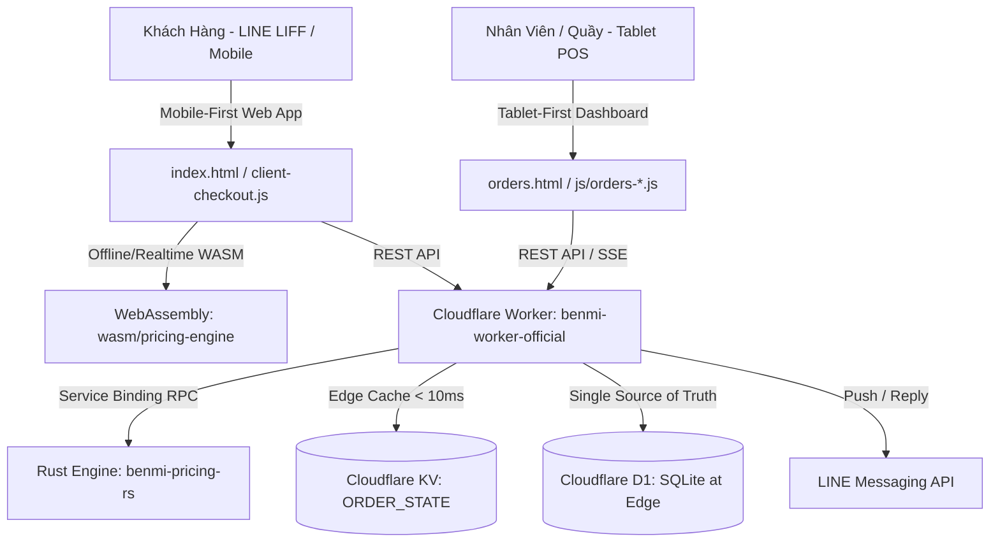

# Benmi Multi-Tenant Order Platform - AI Agent Instructions

Welcome to the **Benmi Multi-Tenant Order Platform** codebase. This document outlines the core architecture, rules, design principles, and development workflows for AI agents working in this repository.

---

## 1. System Architecture Overview

Benmi Order is a serverless, multi-tenant F&B ordering and POS platform built on the Cloudflare ecosystem:

### Directory Structure:
- **`index.html` & `index.css` & `js/client-checkout.js`**: Customer Menu web app, optimized for LINE LIFF In-App Browser (Mobile-First).
- **`wasm/pricing-engine/` & `js/client-pricing-wasm.js`**: WebAssembly module compiled from Rust `pricing-core` for instant, edge-identical cart & bundle calculations on client.
- **`orders.html` & `css/orders.css` & `js/orders-*.js`**: Real-time POS Dashboard for store staff (Tablet/iPad-First).
- **`benmi-worker-official/`**: Cloudflare Workers backend (TypeScript, D1 migrations, KV edge cache, LINE bot webhook).
- **`benmi-pricing-rs/`**: High-performance Rust Workspace:
  - `crates/pricing-core`: Shared pure Rust business logic (Decimal arithmetic, bundle calculations, option graph validator, round builder).
  - `crates/pricing-worker`: Cloudflare Worker co-processor (`workers-rs`) connected via Service Binding (`env.PRICING_ENGINE`).
  - `crates/pricing-wasm`: WebAssembly bindings compiled via `wasm-pack` for browser execution.
- **`docs/proposals/`**: Principal Design Proposals (PDP) for major feature architectures.
- **`.agents/`**: Repository-specific AI Agent Rules and Skills.
- **Bản đồ chỉ mục hàm & file (Đọc đầu tiên để định vị code tức thì, không cần grep)**: Xem chi tiết tại [codebase-map.md](file:///.agents/rules/codebase-map.md).
- **Graphify Knowledge Graph (`graphify-out/`)**: Đồ thị kiến trúc AST toàn hệ thống (13,700+ nodes, 18,200+ edges). Dùng `graphify explain "<symbol>"`, `graphify query "<question>"`, hoặc `graphify path "<A>" "<B>"` để tra cứu tức thì thay vì grep thủ công.

---

## 2. Non-Negotiable Architectural Rules

### A. 1,000+ Multi-Tenant Scalability (Zero Hardcoding)
- **CẤM**: Tuyệt đối không viết code hardcode theo tên quán (VD: `if (tenantId === 'benmi')`, `if (tenantId === 'zhadantongxue')`) hoặc theo slug danh mục (VD: `if (slug === 'drinks')`).
- **BẮT BUỘC**:
  - Mọi khác biệt giữa các quán phải được cấu hình qua `tenant_config` (`features`, `allow_dine_in`, `operating_hours`...) hoặc schema CSDL.
  - Danh mục món và tùy biến phải đọc động từ `allow_customization` và `applied_modifiers` trong D1 CSDL.
  - Xem chi tiết tại: [multi-tenant-scalability.md](file:///.agents/rules/multi-tenant-scalability.md).

### B. UI/UX Design Principles
- **Bảng Quản Lý POS (`orders.html` / `css/orders.css` / `js/orders-*.js`)**:
  - **Ưu tiên 1 (Tablet / iPad First)**: Mọi nút bấm, checkbox, chip tùy biến phải có kích thước tối thiểu **48px**, dễ thao tác nhanh bằng ngón tay tại quầy.
  - **Chuẩn Đa Ngôn Ngữ (I18N)**: Bắt buộc khai báo đầy đủ key trong cả 2 từ điển `I18N["zh-TW"]` (tiếng Trung phồn thể thuần túy) và `I18N["vi"]` (tiếng Việt chuẩn POS). Tuyệt đối không pha trộn ngôn ngữ.
- **Trang Thực Đơn Khách Hàng (`index.html` / `index.css` / `js/client-checkout.js`)**:
  - **Ưu tiên 1 (Mobile / LINE LIFF First)**: Tối ưu hiển thị 1 cột, thao tác 1 tay thuận tiện, thanh toán và giỏ hàng cố định dưới đáy màn hình.
- **Phong Cách Tối Giản & Quy Chuẩn Icon (Minimalist Iconography)**:
  - **Tối giản & Trang nhã**: Phân cấp thông tin bằng typography và khoảng trống thay vì nhồi nhét icon rườm rà.
  - **Không dùng emoji/icon trẻ con**: Cấm dùng `🪑`, `➕`, `🛍️`, `📦`, `🎁`... trong tiêu đề, thông báo, LINE Flex message.
  - **Icon SVG chuẩn thương mại**: Chỉ dùng icon vector SVG nét mảnh cách điệu, 100% miễn phí cho mục đích thương mại (Lucide, Feather, Tabler - MIT/Apache 2.0).
  - Xem chi tiết tại: [ui-design-principles.md](file:///.agents/rules/ui-design-principles.md).

### C. Bắt Buộc Cache-Busting Khi Chỉnh Sửa Frontend (CSS / JS)
- **BẮT BUỘC**: Mọi thay đổi trong các file `css/*.css`, `index.css` và `js/*.js` đều phải đi kèm việc tăng version cache-buster (`?v=YYYYMMDD_...`) trong các file HTML tương ứng (`orders.html`, `index.html`, `marketplace.html`).
- **LÝ DO**: Ngăn ngừa hoàn toàn tình trạng thiết bị POS (iPad/Tablet/Capacitor APK) và LINE LIFF chạy code JS/CSS cũ từ cache.
- Xem chi tiết tại: [frontend-cache-busting.md](file:///.agents/rules/frontend-cache-busting.md).

### D. Chuẩn Kiến Trúc Tùy Chọn Món (Unified Option Groups vs Legacy Modifiers)
- **CẤM Ghi Đúp Key (Zero Dual-Key Writing)**:
  - Khi lưu tùy chọn món trong frontend (`draft.single`, `customizeData`), **BẮT BUỘC** chỉ dùng 1 canonical key duy nhất (`targetKey = group.slug || group.id`).
  - Tuyệt đối không ghi đúp đồng thời cả `modSlug` và `modId` vào `draft.single` (gây nhân đôi tùy chọn trên POS và in bill).
- **Lưu Tên Hiển Thị (Display Names Only)**:
  - Lựa chọn trong `draft.single` và `selectedDetails` phải lưu **tên hiển thị** (`opt.name`), tuyệt đối không lưu ID cơ sở dữ liệu (`optId`).
- **Phân Giải ID & Lọc Trùng (ID Resolution & Deduplication)**:
  - Tầng POS (`orders-core.js`, `printer-service.js`) và Client Checkout (`client-checkout.js`) luôn duy trì từ điển tra cứu ngược (`posOptionIdMap` / `resolveOptionDisplayName`) và lọc trùng `[...new Set(...)]` để đảm bảo hiển thị sạch sẽ và tương thích ngược với các đơn hàng cũ đã có trong CSDL.
- **Tránh Xung Đột Dữ Liệu 2 Tầng (No Schema Hybrid Pollution)**:
  - Toàn bộ menu quán mới hoặc quán sửa đổi phải dùng chuẩn Unified Option Groups (`modifier_groups`, `modifier_options` và `item_modifier_links`).
  - Khi quán đã dùng `modifier_groups`, không gán danh mục modifier cũ qua `menu_categories.applied_modifiers` để tránh sinh ra 2 nhóm tùy biến trùng nhau cho cùng một món.

### E. Tái Sử Dụng Context & Định Vị Qua Graphify (Zero Redundant Search)
- **CẤM GREP MÒ MẪM (Zero Blind Grepping & Hard Gate)**: Khi bắt đầu điều tra bất kỳ tính năng, luồng dữ liệu hay bug nào trong codebase, **BẮT BUỘC** dùng Graphify làm cổng chặn đầu tiên (`graphify query "<tính năng>"` hoặc `graphify explain "<hàm>"`). Tuyệt đối không chạy grep/find mò mẫm qua toàn bộ thư mục khi chưa tra cứu đồ thị.
- **Định Vị Tức Thì Bằng Graphify**:
  - Tra cứu luồng gọi hàm: `graphify explain "<tên_hàm>"` hoặc `graphify path "<A>" "<B>"`.
  - Tra cứu màn hình, chức năng: `graphify query "<mô tả chức năng>"`.
  - Sau khi Graphify trả về node kèm vị trí dòng (`loc=L...`), chỉ đọc đúng dải dòng đó, không đọc tràn lan.
- **Đồng bộ đồ thị AST sau khi code**: Sau khi hoàn thành sửa đổi code, chạy `npm run graphify:update` (hoặc `graphify update .`) để giữ `graphify-out/graph.json` luôn cập nhật (hoàn toàn miễn phí, không tốn LLM API).
- **Chỉnh sửa Tức thì khi Sửa Gấp (Surgical Fast-Fixes)**: Khi người dùng yêu cầu sửa nhanh hoặc sửa gấp, đi thẳng vào các điểm cần sửa, thay đổi tối thiểu, chạy kiểm thử Cấp 1 (`npm run check`) và kết thúc lượt, không kéo dài phân tích.

### F. Động Cơ Tính Giá & Kiểm Định Tùy Chọn Rust (Rust Pricing Engine & WASM)
- **Kiến trúc Chia Sẻ Lõi (Zero Logic Drift)**: Toàn bộ thuật toán tính giá, đối chiếu đơn hàng và xác thực cây tùy chọn đều tập trung tại crate thuần `benmi-pricing-rs/crates/pricing-core`.
  - **Server-Side (Authoritative Boundary)**: Chạy trên Worker `benmi-pricing-rs` kết nối qua Cloudflare Service Binding (`env.PRICING_ENGINE`). Tự động fallback về TypeScript nếu có sự cố hạ tầng kết nối.
  - **Client-Side (Realtime Cart WASM)**: Được biên dịch qua `wasm-pack` thành package `wasm/pricing-engine/` và nhúng vào `index.html` qua `js/client-pricing-wasm.js`. Tính toán tức thì ngay trên thiết bị người dùng (sub-millisecond) với số học thập phân chính xác tuyệt đối (`rust_decimal`).
- **Phạm Vi Trách Nhiệm & Deploy**:
  - `benmi-pricing-rs` là worker tính toán thuần túy (stateless), không chứa dữ liệu quán và không cần deploy lại khi quán thay đổi món, giá hay cập nhật giao diện web thông thường.
  - Chỉ deploy lại Rust Worker khi có thay đổi trong thuật toán khuyến mãi mới hoặc thay đổi schema contract.
  - Lệnh kiểm thử WASM: `npm run test:wasm`. Lệnh build WASM: `npm run build:wasm`.

---

## 3. Database & Caching Architecture

1. **Cloudflare D1 (SQLite at Edge)**:
   - **Production DB**: `blab-db-production` (`48479f91-eec7-4da2-b044-edaaf622f195`)
   - **Staging/Test DB**: `blab-db-test` (`c0152835-7d42-4545-8cb4-6658dfc7e97d`)
   - File migrations nằm tại `benmi-worker-official/migrations/`.
   - **Tenant seed SQL chỉ chạy một lần trên mỗi môi trường thật**. Sau khi áp dụng, dữ liệu D1 hiện tại và các chỉnh sửa của khách/POS là nguồn chuẩn; không chạy lại seed cũ khi deploy, sửa lỗi, kiểm thử hoặc retry tự động.
   - `ON CONFLICT DO UPDATE` vẫn có thể ghi đè thay đổi của khách. Các cập nhật sau phải đọc snapshot mới và tạo bản vá giới hạn đúng phạm vi; chỉ replay toàn bộ khi người dùng yêu cầu rõ việc reset/reseed và đã xác định phạm vi ghi đè.
   - Kiểm thử chạy lặp, nếu cần, chỉ thực hiện trên database cục bộ dùng một lần, không chạy vào D1 Dev/Staging/Production.
2. **Cloudflare Workers KV (`ORDER_STATE`)**:
   - `tenant:{tenant_id}:bootstrap`: Cache toàn bộ Catalog, Modifiers, Branding phục vụ khách tải menu < 10ms.
   - Khi cập nhật menu qua POS hoặc API, bắt buộc gọi `invalidateBootstrapCache(tenantId, env)` để làm mới cache.

---

## 4. Development & Deployment Workflow

| Môi Trường | Git Branch | Cloudflare Worker URL | D1 Database | Fallback LIFF ID |
| :--- | :--- | :--- | :--- | :--- |
| **Dev** | `dev` | `https://platform-worker-dev.thuanmnc.workers.dev` | `blab-db-dev` | `2011224566-kLLdMjkq` |
| **Staging** | `staging` | `https://platform-worker-staging.thuanmnc.workers.dev` | `blab-db-test` | `2009555608-DMioljsI` |
| **Production** | `main` | `https://benmi-worker-official.thuanmnc.workers.dev` | `blab-db-production` | `2009560906-c5taZfiY` |

Backend đã migrate sang Cloudflare `cf` CLI. Cấu hình chính: `benmi-worker-official/cloudflare.config.ts`; `wrangler.config.ts` chỉ cấu hình bundler nội bộ. Dùng Node.js 24 LTS, `npm ci` và `npx cf auth login` trong thư mục backend. Các lệnh backend dưới đây chạy từ `benmi-worker-official/`. Chọn môi trường với `--mode dev`, `--mode test` (staging), hoặc `--mode production`. Không dùng `wrangler deploy` hoặc sửa `wrangler.jsonc` để thay đổi cấu hình triển khai.

### Quy trình Release (Dev -> Staging -> Production):
1. **Kiểm thử tĩnh & Phạm vi biến Frontend (BẮT BUỘC)**:
   - Trước khi deploy frontend, **BẮT BUỘC** chạy: `npm run check` (hoặc `node scripts/check-frontend.js`).
   - Lệnh này kiểm tra cú pháp, phát hiện trùng lặp biến toàn cục (`const`/`let`) giữa các thẻ `<script>`, và mô phỏng khởi tạo trong VM context.
   - **Kiểm tra Cache-Buster**: Đảm bảo các file HTML liên quan (`orders.html`, `index.html`, `marketplace.html`) đã được bump version `?v=...` nếu có file `.css` hoặc `.js` tương ứng bị sửa đổi.
2. **Quy trình Kiểm thử Tinh gọn khi Phát triển (Tiered Testing)**:
   - Trong quá trình code & sửa bug nhỏ: Chỉ dùng `npm run check` kết hợp với file test mục tiêu của module tương ứng (0.5s - 3s).
   - Tuyệt đối không chạy full baseline (`npm run test:release` ~2 phút) cho từng chỉnh sửa nhỏ.
   - Chỉ chạy `npm run test:release` làm cổng nghiệm thu cuối cùng trước khi tạo/merge PR hoặc deploy.
   - Xem chi tiết tại: [testing-workflow.md](file:///.agents/rules/testing-workflow.md).
3. **Phát triển trên Dev**:
   - Lập trình và kiểm thử trên nhánh `dev`.
   - Apply migration: `npm run db:migrations:apply:dev`.
   - Deploy backend dev: `npm run deploy:dev`.
4. **Kiểm thử QA & Demo trên Staging**:
   - Hợp nhất `dev` vào `staging`: `git checkout staging && git merge dev && git push origin staging`.
   - Apply migration: `npm run db:migrations:apply:staging`.
   - Deploy backend staging: `npm run deploy:staging`.
5. **Phát hành chính thức (Production)**:
   - Hợp nhất `staging` vào `main`: `git checkout main && git merge staging && git push origin main`.
   - Apply migration: `npm run db:migrations:apply:production`.
   - Deploy backend production: `npm run deploy`.
