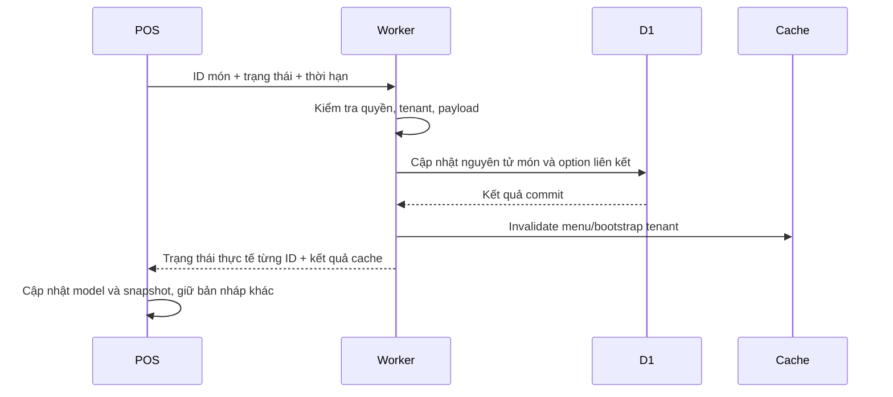

# PDP: Bật/tắt còn hàng theo lô [New]

Ngày: 2026-11-15. Trạng thái: đã tách trên nhánh `feat/bulk-stock-availability`, kiểm thử cục bộ; chưa deploy.

### Ghi nhận triển khai

- Entry point: `orders.html` → Quản lý thực đơn → danh mục món → Chọn nhiều. Đã phục hồi toolbar tìm kiếm/lọc vì HTML hiện tại đã bỏ toolbar dù logic lọc vẫn còn.
- Controller: `js/orders-stock-batch.js`; style dùng chung `css/orders-stock.css`; từ điển trong `js/orders-i18n.js`. Các tài nguyên trong `orders.html` đã tăng cache-buster.
- API: `benmi-worker-official/src/modules/menu-stock-batch.ts`, route `POST /api/menu/stock-status/batch`. Xác thực qua POS session hiện có, dùng D1 batch và điều kiện kiểm tra đầy đủ ID trong cùng transaction; tối đa 100 ID; đồng bộ option liên kết và invalidate cache sau commit.
- Không đổi API đơn món. Helper chuẩn hóa expiry của API lô độc lập để giữ nguyên tương thích caller cũ. Client đóng băng thời điểm hết hàng thành ngày cụ thể trước khi gửi; khi không nhận được phản hồi, retry cùng payload. Chưa thêm endpoint đọc đối soát riêng; retry là lệnh đặt lại cùng trạng thái, áp dụng quy tắc ghi sau cùng thắng đã nêu.
- POS session được đóng gói độc lập trong nhánh này với migration `0092_pos_session_attempts.sql`. Không chứa state machine, endpoint command hoặc migration `0090_order_commands.sql` của lifecycle. Khi hợp nhất lifecycle sau này, dùng lại migration này và bỏ phần tạo trùng `pos_session_attempts` khỏi migration lifecycle.
- Đã chạy `npm run check`, Worker TypeScript, `npm run test:stock-batch`, regression menu/drawer, customer validation và POS session; đã cập nhật Graphify. Browser QA dùng Chromium/WebKit, 3 viewport và 2 ngôn ngữ; ảnh tại `artifacts/menu-qa/bulk-stock-local/`.
- Một test cũ `tests/test_sold_out_order_modification.js` thất bại ở assertion nguồn `liff.sendMessages` trong `js/client-checkout.js` đang có thay đổi từ trước. Không sửa luồng checkout trong tính năng này. Chưa chạy full release gate vì chưa tạo PR/deploy.

## 1. Mục tiêu và phạm vi

Nhân viên chọn nhiều món rồi báo hết hàng hoặc mở bán lại trong một lần áp dụng, ngay tại Quản lý thực đơn. Mục tiêu UX: cập nhật cả danh mục với tối đa 5 lần chạm từ màn hình danh mục, không phải mở từng món.

V1 hỗ trợ món đã lưu, bao gồm món combo như một sản phẩm. Không quản lý số lượng tồn kho, không tự suy luận tồn nguyên liệu, không cập nhật độc lập hàng loạt topping/tùy chọn. Tùy chọn liên kết tới sản phẩm vẫn phải đồng bộ theo quy tắc hiện tại.

## 2. Hiện trạng đã khảo sát

- `js/orders-menu.js`: danh sách có lọc còn/hết hàng; `openStockModal()` mở drawer từng món; `applySavedStockStatus()` cập nhật dữ liệu hiện tại và snapshot đã lưu để giữ bản nháp chỉnh sửa khác.
- `orders.html`, `css/orders-stock.css`: có stock drawer, thao tác nhanh và chọn ngày. Tiếp tục dùng ngôn ngữ thiết kế này.
- `benmi-worker-official/src/modules/menu.ts:updateStockStatus()`: API đơn món nhận tên/danh mục; lưu `menu_items.out_of_stock_until`, đồng bộ `modifier_options.product_id`, xóa menu/bootstrap cache.
- Thời hạn “hôm nay” hiện dùng 04:00 ngày hôm sau GMT+7. Không âm thầm đổi quy tắc này trong tính năng theo lô; giao diện phải hiển thị giờ khôi phục cụ thể. Nếu triển khai múi giờ theo tenant, tách thành thay đổi dùng chung cho cả thao tác đơn và lô.
- `tests/test_stock_drawer_browser.cjs`: đã có kiểm thử Chromium/WebKit, tablet/điện thoại và vi/zh-TW để mở rộng.
- Working tree đang có nhiều thay đổi khác, kể cả menu. Các vị trí và hợp đồng cần đối chiếu lại khi bắt đầu code; không ghi đè công việc đang có.

## 3. Thiết kế đề xuất

### Trải nghiệm chính

1. Trong danh mục món, thêm nút **Chọn nhiều** cạnh tìm kiếm/bộ lọc.
2. Chuyển sang chế độ chọn: mỗi dòng có checkbox, bấm vùng tên món để chọn. Khóa các điều khiển sửa/xóa/kéo thả trong chế độ này để tránh thao tác nhầm; bản nháp đã có vẫn được giữ.
3. Cho phép **Chọn tất cả N kết quả** theo danh mục và bộ lọc hiện tại; checkbox tổng có trạng thái chọn một phần. Thêm **Bỏ chọn**.
4. Thanh thao tác cố định dưới vùng danh sách: **Đã chọn N món · Báo hết hàng · Mở bán lại**. Khi chưa chọn, hai hành động bị vô hiệu hóa.
5. Báo hết hàng mở drawer có ba lựa chọn: **Hết hôm nay**, **Đến ngày…**, **Đến khi mở lại**. Mặc định hôm nay. Footer ghi rõ **Áp dụng cho N món**; chỉ ghi dữ liệu khi bấm nút này.
6. Mở bán lại mở drawer gọn với số món và nút **Mở bán lại N món**. Đây là bước kiểm tra cuối cùng, không chồng thêm hộp xác nhận.
7. Thành công: thông báo số món đã cập nhật, số món đã ở trạng thái yêu cầu; làm mới trạng thái, xóa lựa chọn và giữ danh mục/bộ lọc/vị trí cuộn.

Wireframe định hướng (dùng cùng style POS hiện tại):

```text
Món chính                               [Xong]
[Tìm tên món…]     [Tất cả | Còn hàng | Hết hàng]
[ ] Chọn tất cả 12 kết quả          [Bỏ chọn]

[x] Cơm gà                        Còn hàng
[x] Cơm bò                        Còn hàng
[ ] Cơm chay                      Hết hàng

─────────────────────────────────────────────
Đã chọn 2 món   [Báo hết hàng] [Mở bán lại]
```

### Quy tắc tránh nhầm lẫn

- V1 chọn trong một danh mục; đổi danh mục sẽ bỏ chọn và thông báo ngắn. Đổi tìm kiếm/bộ lọc chỉ giữ phần lựa chọn còn thuộc kết quả mới; thông báo số đã bỏ. Không có món được chọn ẩn ngoài bộ lọc.
- “Tất cả kết quả” gồm cả dòng ngoài viewport, không chỉ các dòng đang nhìn thấy; phải hiển thị đúng tổng số.
- Dùng Set ID sản phẩm, không dùng tên hoặc chỉ số dòng. Món mới chưa được lưu không được chọn; ghi rõ “Lưu món trước”.
- Drawer hiển thị số lượng và danh sách thu gọn có thể mở rộng. Món đang hết hàng vẫn được chọn để đổi hạn; chỉ tính là không đổi nếu trạng thái và thời hạn cùng khớp.
- Đang gửi: khóa gửi lặp, hiện “Đang cập nhật N món…”. Lỗi: giữ lựa chọn/thời hạn, hiển thị lỗi tại drawer và nút thử lại. Không hiển thị thành công trước phản hồi máy chủ.
- Mất phản hồi: đọc lại trạng thái trước khi cho thử lại; giữ nguyên thời điểm hết hàng đã chuẩn hóa để retry không kéo dài hạn qua ngày mới.
- Không thêm Undo ở V1: thao tác đảo cần bảo vệ thay đổi của thiết bị khác. Người dùng có thể mở bán lại qua cùng luồng.

### Tablet, accessibility và ngôn ngữ

- Vùng chạm của nút/checkbox tối thiểu 48×48px; khoảng cách đủ tránh chạm nhầm, không phụ thuộc hover/nhấn giữ.
- Tablet: drawer bên phải. Điện thoại: sheet gần toàn màn hình; footer luôn nhìn thấy, có chừa khoảng cuộn và safe area.
- Trạng thái có chữ, không chỉ màu; checkbox semantic, hỗ trợ bàn phím, focus trap và trả focus khi đóng drawer, aria-live cho số chọn/kết quả.
- Khai báo đầy đủ vi/zh-TW trong `js/orders-i18n.js`; dùng SVG hiện có khi cần, không thêm emoji trang trí.

### Backend và dữ liệu

Đề xuất `POST /api/menu/stock-status/batch` với tenant lấy từ ngữ cảnh xác thực, không tin tenant trong body:

```json
{
  "item_ids": ["item_1", "item_2"],
  "status": "out_of_stock",
  "duration": "today"
}
```

`status`: chỉ `in_stock` hoặc `out_of_stock`. Khi hết hàng, duration bắt buộc thuộc `today`, `multiple_days`, `indefinite`; ngày cụ thể phải hợp lệ và ở tương lai. Khi mở bán, xóa thời hạn. Response trả ID, trạng thái và expiry chuẩn từ server, số changed/unchanged; không chỉ trả success boolean.

- Giới hạn đề xuất 100 ID/lần, khử trùng ID. UI ghi rõ giới hạn và không tự chia thành nhiều lượt ghi âm thầm; chọn tất cả khi vượt giới hạn phải yêu cầu thu hẹp bộ lọc.
- Kiểm tra quyền sửa menu phía server, tenant isolation và toàn bộ ID trước khi ghi. Chỉ cần một ID không hợp lệ/không còn tồn tại thì trả lỗi toàn lô, không lộ dữ liệu tenant khác.
- Dùng một đơn vị cập nhật nguyên tử cho sản phẩm và các option liên kết `product_id`; kiểm tra giới hạn binding/transaction của D1 khi triển khai. Không bắn N request tới API đơn món; không lưu lại toàn bộ menu.
- Không dùng fallback tìm tên sang customizations trong API lô. Không thay đổi giá, nội dung, trạng thái xuất bản hoặc cấu hình combo.
- Tách chuẩn hóa thời hạn thành helper dùng chung với API đơn; giữ tương thích caller cũ.
- Chưa cần migration cho trạng thái tồn kho. Quy tắc đồng thời V1: lệnh ghi sau cùng thắng; không tuyên bố có phát hiện xung đột. Nếu cần optimistic concurrency, bổ sung revision ở thiết kế riêng.
- Sau commit, invalidate menu/bootstrap cache một lần cho tenant. Phân biệt lỗi ghi với lỗi làm mới cache: không báo “chưa lưu” nếu DB đã commit; có retry invalidation và log cảnh báo. Không hứa mọi thiết bị mở sẵn đồng bộ tức thì; kiểm chứng cơ chế refresh hiện có trước khi quyết định cần event mới.
- POS áp dụng response vào cả model và saved snapshot; chỉ sửa trường stock, giữ các sửa tên/giá chưa lưu. Menu save sau đó không được phục hồi stock cũ.
- Menu khách có thể còn cache/giỏ cũ: kiểm thử đường gửi đơn để bảo đảm server từ chối món vừa hết hàng; việc refresh giao diện không thay thế kiểm tra tại server.



## 4. Phương án cân nhắc

| Phương án | Ưu điểm | Hạn chế | Quyết định |
|---|---|---|---|
| Chọn nhiều ngay danh sách | Giữ ngữ cảnh, tận dụng tìm kiếm/lọc | Cần quản lý selection | Chọn |
| Màn quản lý tồn riêng | Giao diện chuyên biệt | Thêm điều hướng và UI trùng lặp | Chưa cần |
| Lặp API đơn món | Ít code backend | N request, lỗi từng phần, invalidate nhiều lần | Không chọn |

## 5. Triển khai và rollback

1. Chốt hợp đồng API, quyền truy cập thực tế, expiry và giới hạn lô; đối chiếu menu đang thay đổi trong workspace.
2. Thêm backend và test mục tiêu; giữ API đơn món hoạt động.
3. Thêm selection, thanh thao tác và drawer lô; i18n; cập nhật snapshot và cache-buster của HTML cho mọi CSS/JS thay đổi.
4. QA trên dev rồi staging; triển khai backend trước frontend. Production tuân thủ clean main/origin/main và release gate của repository.
5. Rollback bằng tắt/gỡ entry “Chọn nhiều”, giữ thao tác đơn món. Không đảo dữ liệu stock đã được nhân viên cập nhật. Chỉ rollback backend sau khi frontend ngừng gọi API mới.

## 6. Quan sát và hiệu năng

Log request ID, tenant, số ID, số thay đổi, latency, lỗi DB/cache và actor nếu session có; không log token. Theo dõi tỷ lệ lỗi và thời gian xử lý theo kích thước lô. Không hardcode quán/danh mục. Truy vấn và cập nhật luôn có tenant_id; xác minh index và giới hạn truy vấn với dữ liệu thử khi triển khai.

## 7. Kiểm thử và tiêu chí nghiệm thu

- Backend: 0/1/100/101 ID, ID trùng, sai tenant, ID bị xóa, enum/ngày sai, cập nhật nguyên tử khi lỗi, options liên kết, retry cùng expiry, commit thành công nhưng cache thất bại.
- Frontend: chọn/bỏ chọn/chọn tất cả/chọn một phần; thay filter/category; giữ bản nháp giá/tên; lô trạng thái trộn; món mới; gửi lặp; mất mạng/mất phản hồi; server trả số lượng đúng.
- Tích hợp: mở bán lại, hết hôm nay, đến ngày, vô hạn; tên món trùng; combo liên kết; khách có giỏ cũ; kiểm tra cả luồng tạo/sửa/thêm món có liên quan.
- Browser: Chromium và WebKit, 1024×768, 768×1024, 390×844; cả vi/zh-TW; keyboard/focus và footer không che dòng cuối.
- UX nghiệm thu: cả danh mục trong giới hạn lô có thể báo hết hôm nay trong tối đa 5 lần chạm; không sửa món ngoài phạm vi chọn; lỗi không làm mất selection.
- Khi code: `npm run check` + test module mục tiêu; cập nhật Graphify sau sửa code; `npm run test:release` một lần ở cổng PR/deploy. Chỉ kế hoạch nên chưa chạy kiểm thử ứng dụng hay cập nhật đồ thị.
