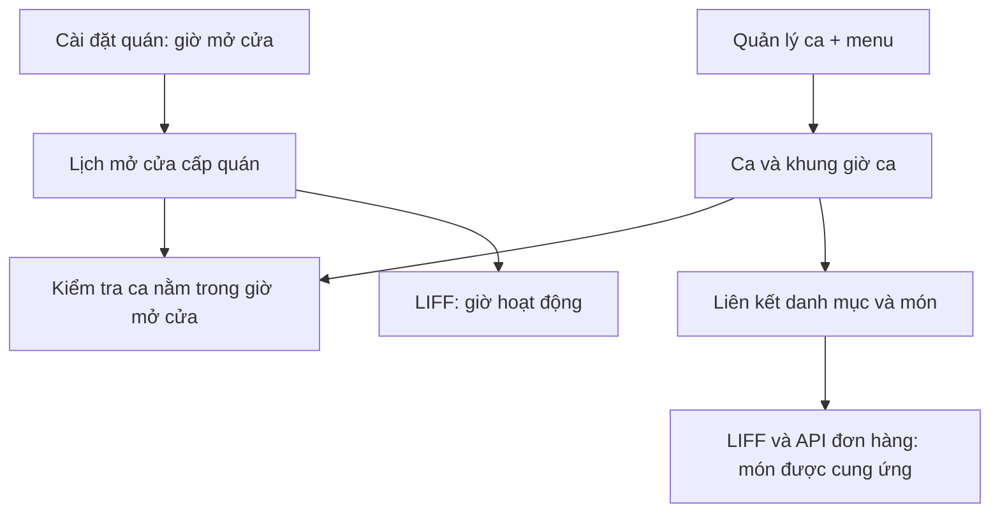

# PDP: Giờ mở cửa và quản lý ca bán món — Refactor

Trạng thái: Đã triển khai và kiểm chứng trên Dev ngày 2026-11-18 theo xác nhận của người dùng: giờ mở cửa là vùng bao phủ các ca. Chọn phương án giữ schema dữ liệu hiện tại, chuyển CRUD ca và thêm validation + revision guard; chưa thực hiện phần chuẩn hóa bảng tùy chọn.

## 1. Mục tiêu

Giờ mở cửa là lịch cấp quán hiển thị trên LIFF. Ca bán món được tạo và chỉnh sửa tại trang quản lý ca + menu, có thời gian nằm hoàn toàn trong lịch mở cửa tương ứng. Thay đổi ca không tự ghi lại giờ mở cửa. Số ca tùy cấu hình từng tenant; ba ca là dữ liệu của quán, không phải giới hạn hệ thống.

Phạm vi là lịch tuần, quản lý ca và phân món theo ca. Lịch nhận đơn trước, lịch giao hàng, ngày lễ và ca làm việc nhân viên là các khái niệm riêng, cần yêu cầu rõ trước khi đưa vào mô hình này.

## 2. Kiến trúc hiện tại

Migration `benmi-worker-official/migrations/0094_relational_operating_hours_and_menu_shifts.sql` đã tạo các bảng ca từ khi thêm tính năng. Lần sửa tách giờ khỏi ca ngày 2026-11-17 không thay đổi schema.

| Dữ liệu | Nguồn hiện tại |
| --- | --- |
| Giờ mở cửa quán | JSON `tenant_config.operating_hours` |
| Tên ca, trạng thái, thứ tự | `tenant_operating_shifts` |
| Khung giờ theo thứ của từng ca | `tenant_operating_hours`, có `shift_id` |
| Phân ca cho danh mục/món | `menu_category_shifts`, `menu_item_shifts` |

Tên `tenant_operating_hours` hiện dễ gây hiểu nhầm: bảng này chứa khung giờ của ca, không phải lịch mở cửa độc lập của quán.

Luồng hiện tại: `orders-settings.js` → `/api/config` → `config.ts` → `saveTenantOperatingShifts()` hoặc repository cập nhật cấu hình → D1 → xóa cache bootstrap/config → `bootstrap.ts` → LIFF/POS. Trang `orders-menu-schedule.js` hiện quản lý phân món vào các ca đã có thông qua `menu-schedule-settings.ts`.

Backend hiện kiểm tra định dạng giờ và quyền sở hữu ca, chưa bắt buộc mọi ca nằm trong giờ mở cửa. Kiểm tra cung ứng món khi tạo/sửa đơn đi qua `validateCatalogScheduleForItems()`; các consumer cần được chuyển cùng đợt khi thay đổi quy tắc.

## 3. Kiến trúc đề xuất

Chuyển trình tạo/chỉnh ca sang trang quản lý ca + menu. Phần cài đặt quán chỉ quản lý giờ mở cửa. Trang ca hiển thị lịch mở cửa làm ngữ cảnh và báo rõ khoảng giờ không hợp lệ.

### Mô hình dữ liệu

Không cần đổi bảng chỉ để chuyển vị trí giao diện hoặc thêm kiểm tra phạm vi. Có thể giữ schema hiện tại cho bước đầu.

Nếu thực hiện refactor database để làm rõ trách nhiệm, đề xuất:

| Bảng | Trách nhiệm |
| --- | --- |
| `tenant_business_hours` mới | Lịch mở cửa quán: `id`, `tenant_id`, `day_of_week`, `start_time`, `end_time`, trạng thái và timestamp |
| `tenant_operating_shifts` hiện có | Metadata của ca; giữ nguyên ID và liên kết hiện tại |
| `tenant_shift_windows` | Tên đích rõ nghĩa cho bảng khung giờ ca hiện tại; giữ ID, `shift_id`, ngày, giờ và trạng thái |
| Hai bảng liên kết hiện có | Danh mục và món thuộc ca nào |

Mỗi bảng có chỉ mục theo tenant và các khóa ngoại phù hợp. Không cố định tên ca hay số ca. Không cần gắn mỗi khung ca với một ID khung mở cửa: quan hệ nghiệp vụ là được bao phủ bởi lịch mở cửa của cùng tenant, có thể gồm nhiều khoảng liền nhau.

### Quy tắc và hợp đồng API

- Mọi khoảng ca đang hoạt động phải được phủ hoàn toàn bởi hợp các khoảng mở cửa tương ứng. Ca không được bắc qua một khoảng nghỉ giữa ngày.
- Chuẩn hóa lịch theo tuần và timezone của lịch quán, xử lý ca qua nửa đêm, ranh giới tuần và `24:00`. Khoảng thời gian dùng đầu vào bao gồm, đầu ra loại trừ để hai ca liền nhau không bị coi là chồng lấn.
- Cho phép các ca chồng nhau vì món có thể cùng được cung ứng ở nhiều ca.
- Đề xuất endpoint riêng cho CRUD ca, ví dụ `/api/menu/shifts`; endpoint phân món hiện tại tiếp tục chỉ cập nhật trường lịch và liên kết.
- Khi lưu ca, backend đọc lịch mở cửa chuẩn từ D1, kiểm tra quyền sở hữu và phạm vi rồi mới ghi. Frontend kiểm tra sớm để phản hồi nhanh.
- Khi thu hẹp giờ mở cửa, nếu ca hiện tại trở nên không hợp lệ thì trả lỗi có danh sách ca và khoảng giờ bị ảnh hưởng. Không tự cắt giờ ca, xóa liên kết hay mở rộng giờ quán.
- Mọi đường ghi phải kiểm tra cùng một quy tắc. Chống ghi đồng thời bằng revision được kiểm tra trong cùng batch/transaction với mutation; thay đổi giờ mở cửa và thay đổi ca đều phải tham gia revision này.
- LIFF tiếp tục nhận `parsedHours`/`formattedHours` và danh sách ca riêng. Thời điểm kiểm tra món phải thống nhất giữa khách chọn giờ nhận, API tạo/sửa/gọi thêm món, và giao diện staff.
- Mô hình mới chỉ cần một loại ca cung ứng món; hai giá trị `operating`/`menu_window` hiện tại cần được rà dữ liệu và chuyển có chủ đích, không tiếp tục mang nghĩa tự mở cửa quán.

## 4. Migration và rollout

1. Chốt ý nghĩa giờ mở cửa, giờ nhận đơn và thời điểm áp dụng ca trước khi thay đổi dữ liệu.
2. Đọc snapshot mới; lập báo cáo các ca nằm ngoài giờ mở cửa. Không replay seed tenant và không tự sửa lịch của khách.
3. Nếu chuẩn hóa DB, tạo bảng mở cửa mới rồi backfill có kiểm tra từ JSON. Giữ nguyên ID ca, khung giờ và liên kết. Dữ liệu JSON không hợp lệ cần được báo cáo, không thay bằng lịch mặc định.
4. Triển khai adapter đọc với một nguồn chuẩn được chọn rõ ràng theo cấu hình rollout. Không ghi đồng thời JSON và bảng mới như hai nguồn chuẩn.
5. Chuyển đồng bộ mọi writer, reader, kiểm tra đơn, bootstrap và cache invalidation sang nguồn mới. Đổi tên bảng khung ca chỉ khi code và trigger/index đã được chuẩn bị tương thích.
6. Chuyển Dev trước; cập nhật bootstrap version, cache KV và cache-buster frontend. Staging/Production theo quy trình release của repo.

Rollback UI/API riêng nếu chưa chuyển nguồn dữ liệu. Sau khi nguồn quan hệ đã nhận cập nhật mới, rollback dữ liệu phải xuất từ nguồn mới nhất về định dạng cũ; không dùng lại snapshot JSON cũ vì sẽ mất các chỉnh sửa sau cutover.

## 5. Phương án khác và đánh đổi

- Giữ schema hiện tại, chỉ thêm validation và chuyển UI: ít migration, đáp ứng yêu cầu ngay; tên bảng khung ca vẫn khó hiểu và lịch mở cửa vẫn là JSON. Đây là bước đầu phù hợp nếu chưa cần chuẩn hóa toàn bộ DB.
- Chuẩn hóa lịch mở cửa thành bảng riêng: trách nhiệm rõ hơn, dễ truy vấn và mở rộng; phải chuyển tất cả consumer và quản lý rollback dữ liệu.
- Suy ra giờ mở cửa bằng tổng các ca: không chọn vì sửa ca sẽ lại làm đổi lịch hiển thị của quán.

## 6. Các yêu cầu xuyên suốt

API dùng xác thực/quyền hiện có, tenant scope cho mọi truy vấn và kiểm tra ID liên kết. Log lỗi validation gồm tenant, ca và khoảng thời gian bị ảnh hưởng, không chứa thông tin đăng nhập. Theo dõi lỗi xung đột revision và lỗi ca ngoài lịch.

Tải lịch theo tenant trong batch, dùng cùng DTO cho browser/backend và cache trong bootstrap. Sau mutation gọi `invalidateBootstrapCache()` và làm mới các cache có chứa lịch liên quan. Kiểm tra ghi luôn dựa trên D1 thay vì tin snapshot KV/browser.

## 7. Kế hoạch thực hiện

- [x] Chốt ý nghĩa lịch: giờ mở cửa là khung bao phủ các ca; cập nhật phạm vi giờ Dev một lần theo snapshot mới.
- [x] Giữ JSON giờ quán và bảng ca hiện có; migration 0095 bổ sung revision cho thay đổi giờ quán.
- [x] Bổ sung validator phạm vi tuần và bảo vệ mutation đồng thời cho POS/config/admin.
- [x] Chuyển CRUD ca sang trang ca + menu; giữ riêng phần cài đặt giờ quán.
- [x] Giữ contract LIFF/POS và kiểm tra món hiện có; đồng bộ cache và bản dịch `zh-TW`/`vi`.
- [x] Kiểm thử: release 45/45, targeted 23/23, WebKit 3/3; rollout Dev và kiểm chứng API + POS/LIFF. Staging/Production chưa triển khai.

## 8. Kế hoạch kiểm chứng và điểm cần chốt

Kiểm thử ca vừa khít ranh giới, ngoài giờ, ngày nghỉ, nhiều khoảng mở cửa, khoảng nghỉ, ca qua đêm, giao tuần, ca chồng nhau và tenant khác. Kiểm tra thu hẹp giờ quán không ghi một phần hoặc làm mất liên kết. Kiểm tra hai thiết bị đồng thời sửa ca/giờ quán.

Kiểm thử đầy đủ tạo/sửa/gọi thêm món, lịch nhận đã chọn, staff, cache cũ, bản dịch và thao tác tablet tối thiểu 48px. Chạy static/type checks, test mục tiêu và release baseline trước phát hành.

Lịch đã khôi phục ngày 2026-11-17 là thứ Hai 09:00–11:30 và 17:00–19:00; thứ Ba–thứ Sáu 09:00–11:30; cuối tuần nghỉ. Các ca đã thêm gồm trưa 11:00–13:30, tối 16:30–19:00 và khuya 21:00–22:30 theo ngày tương ứng. Chúng chưa đáp ứng ràng buộc mới. Cần xác nhận lịch 09:00–11:30 là giờ mở cửa thực tế hay giờ nhận đơn trước; nếu là giờ nhận đơn thì phải mô hình hóa riêng thay vì dùng làm giới hạn cho ca phục vụ.

## Kết quả Dev

Migration 0095 chỉ bổ sung trigger revision, không đổi tên bảng và không tạo bảng giờ mở cửa mới. Lịch một lần được cập nhật theo snapshot: thứ Hai–thứ Năm 11:00–22:30; thứ Sáu 11:00–19:00; cuối tuần nghỉ. Cả ba ca, 14 window và liên kết món giữ nguyên. Bằng chứng tại `artifacts/menu-shifts-20261118/`.
