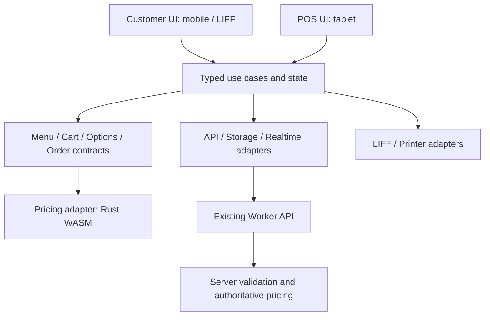

# PDP: Frontend Modernization — Migrate

Ngày: 2026-11-11 (cập nhật 2026-11-14). Trạng thái: Đã chốt 3 quyết định nền tảng; hoàn thành PR 1–4 và phát hành lên `staging`/`main` (`db69bdd1`), triển khai tab History & Order Detail chỉ đọc bằng React + TypeScript + Vite thay thế `js/orders-history.js` trong `dist/orders.html`. Bước tiếp theo chuyển theo **đợt Quick Win (QW1–QW5)** ít rủi ro trước khi chạm cụm lớn PR 5–7.

### Quyết định đã chốt (2026-11-11)
1. **UI Runtime**: **React + Vite + TypeScript (`strict`)**. Ưu tiên hệ sinh thái chuẩn, ít rủi ro tương thích; phần Customer LIFF tách chunk riêng và đo hiệu năng thật trước khi mở rộng.
2. **Lát cắt UI đầu tiên (PR 4)**: **Tab History & Order Detail chỉ đọc** trong POS ([`js/orders-history.js`](file:///Users/duccao/Documents/benmi-order/js/orders-history.js)) — phạm vi gọn, không chạm side-effect in ấn/thanh toán/giỏ hàng, dùng để kiểm chứng cầu nối legacy, CSS scope, i18n `zh-TW`/`vi` và deploy `dist/`. Chi tiết bản đồ phụ thuộc tại [`history_slice_dependency_map.md`](file:///Users/duccao/Documents/benmi-order/docs/proposals/frontend_modernization/history_slice_dependency_map.md).
3. **Contracts & Ranh giới Backend**: Giữ nguyên `benmi-worker-official/` build/deploy độc lập; định nghĩa `frontend/shared/contracts/` bám đúng JSON DTO API công khai và khóa khớp bằng contract test (tránh lẫn các trường nội bộ nhạy cảm như `lineChannelToken`, `groqApiKey` trong `TenantContext`).

## 1. Tóm tắt và mục tiêu

Đề xuất chuyển frontend sang TypeScript, ES modules và Vite, xây dựng UI bằng React theo từng màn hình. Hai ứng dụng customer và POS có entry riêng, chia sẻ contract, logic nghiệp vụ và thành phần UI cơ bản. Bắt đầu ở POS; customer chuyển sau khi kiểm chứng trên thiết bị LINE LIFF.

Mục tiêu: loại bỏ dependency ngầm qua globals ở phần được chuyển; tách state khỏi DOM; giữ đúng giá, tùy chọn, snapshot đơn và hành vi in; giảm chi phí sửa lỗi và xây tính năng. Tất cả khác biệt tenant đi qua cấu hình/schema, không rẽ nhánh theo tên quán.

Phạm vi: build pipeline, module boundaries, state, component, i18n, accessibility, delivery và kiểm thử frontend. Đợt đầu giữ API/schema hiện hành; không reseed dữ liệu, không thay lõi Rust hoặc thiết kế lại backend. Thay đổi backend cần thiết về sau phải có đề xuất riêng.

## 2. Hiện trạng và bằng chứng

Khảo sát qua Graphify và đọc code cục bộ. Chưa chạy UI trên thiết bị thật, chưa đo bundle, Core Web Vitals hoặc tỷ lệ lỗi production. Nhận xét hiệu năng/UX dưới đây là hướng cần kiểm chứng, không phải kết quả benchmark.

| Quan sát | Bằng chứng | Ý nghĩa |
|---|---|---|
| Customer/POS tải nhiều classic scripts theo thứ tự | `index.html:991`, `orders.html:3327` | Dependency nằm ngoài import graph; thứ tự khai báo có thể ảnh hưởng hành vi |
| State customer chia trên nhiều global object | `js/client-core.js:49` | Cart, tùy chọn và combo cần đồng bộ thủ công |
| Tính tổng, đọc form và dựng HTML cùng nằm trong một hàm | `js/client-cart.js:576` | Khó kiểm thử từng trách nhiệm và chuyển UI độc lập |
| Checkout lấy subtotal từ `#total-price.innerText` rồi trừ phụ thu | `js/client-checkout.js:2480` | Quy tắc nghiệp vụ phụ thuộc DOM trình bày; không đồng nghĩa backend tin giá từ client |
| Fetch đơn đồng thời phát hiện thay đổi, cảnh báo, gọi máy in và render | `js/orders-core.js:1083` | Side effect gắn với vòng đồng bộ; cần bảo toàn chống lặp khi chuyển |
| Có model menu đã tách DOM và global state | `js/orders-menu-model.js:1` | Nền tốt để tiếp tục tách domain, không cần viết lại logic này |
| Có tokens, font scaling và bộ test nghiệp vụ/browser | `css/orders.css:1`, `package.json` | Tiếp tục phát triển nền hiện có |

Kích thước tại thời điểm khảo sát: `orders-menu.js` 5.747 dòng; `client-checkout.js` 3.566 dòng; `css/orders.css` 13.644 dòng. Số dòng chỉ là tín hiệu về phạm vi trách nhiệm, không tự chứng minh lỗi hay chậm.

## 3. Kiến trúc đề xuất



### Ranh giới module

```text
frontend/
  apps/customer/       # Catalog, option picker, cart, checkout
  apps/pos/            # Live orders, menu editor, settings, reports
  shared/contracts/   # Bootstrap, option selection, order snapshot
  shared/domain/      # Pure state transitions and normalization
  shared/ui/          # Tokens, button, field, dialog, drawer, feedback
  shared/infra/       # API client, storage, runtime configuration
  adapters/           # Legacy, pricing, LIFF, printer, realtime
```

Một build workspace đủ dùng ở giai đoạn đầu. Không cần thêm công cụ monorepo hoặc tách thành nhiều package phát hành độc lập.

### State và contract

- Phân biệt dữ liệu server, bản nháp người dùng và trạng thái giao diện. Response mới không được âm thầm ghi đè bản nháp đang sửa.
- Cart là model có kiểu rõ ràng; subtotal/total và validation là dữ liệu dẫn xuất từ model qua pricing adapter. UI chỉ trình bày, không đọc tiền ngược từ text.
- Dùng ID ổn định cho item/line identity trong model mới. Adapter tương thích chuyển đổi các cart key cũ; kiểm thử tên có dấu, dấu gạch dưới và đổi tên món.
- Giữ quy tắc option hiện tại: một canonical group key `slug || id`, giá trị hiển thị là tên; ID phục vụ liên kết/validation phải ở trường có nghĩa riêng, không ghi hai alias.
- Chuẩn hóa dữ liệu legacy tại boundary. Giữ đọc đơn cũ và snapshot hiện hành; không rải nhánh legacy khắp component.
- Checkout có các trạng thái tường minh: chỉnh sửa, xác thực, gửi, chờ kết quả, thành công, lỗi có thể xử lý. Phân biệt thất bại chắc chắn với timeout chưa biết server đã nhận hay chưa. Retry ghi đơn phải dùng contract idempotency đã xác minh.
- Cache/storage keys phải gắn tenant và môi trường; xóa subscription/cache nhạy cảm khi đổi phiên hoặc tenant. Không persist token tùy tiện.

### UI và CSS

- POS: tách tác vụ vận hành đơn khỏi quản trị menu/cài đặt. Trên tablet ngang, thử bố cục danh sách và chi tiết cạnh nhau để giảm đóng/mở modal. Trên màn hình hẹp, chuyển về một pane.
- Customer: ưu tiên danh mục, chọn món, tùy chọn, giỏ hàng và xác nhận. Dùng progressive disclosure cho cấu hình phức tạp; giữ tổng tiền và hành động chính dễ thấy, có safe-area spacing.
- Menu editor: giữ bản nháp, hiển thị phạm vi thay đổi và lỗi tại đúng trường; bảo toàn luồng lưu/xóa đang có và dữ liệu chỉnh từ POS.
- Mở rộng CSS variables hiện có thành token theo vai trò: surface, text, border, status, action, spacing, typography. Tenant chỉ ghi đè token thương hiệu được cho phép; màu trạng thái vận hành vẫn rõ nghĩa.
- CSS theo component/feature; phần UI mới dùng phạm vi riêng để tránh bị CSS legacy ảnh hưởng. Xóa CSS cũ sau khi gỡ consumer, không xóa theo số dòng.
- Component chung chịu trách nhiệm focus, keyboard, trạng thái loading/error/disabled và nhãn truy cập. POS giữ vùng bấm tối thiểu 48px; từ điển zh-TW/vi phải đủ key.
- Chỉ có một owner cho mỗi vùng DOM và mỗi state. Bridge legacy chỉ chuyển action/data, không để React và classic script cùng sửa một subtree.

### Build và hiệu năng

Vite xây các entry riêng; lazy-load menu editor, báo cáo, thanh toán khi phù hợp. Giữ URL, query parameter, LIFF redirect, asset base và môi trường hiện hành. Thử nghiệm bằng production build để phát hiện lỗi path/WASM/chunk.

Chuyển asset đã migrate sang tên có content hash. Các file legacy vẫn bắt buộc bump `?v=` theo quy định hiện tại. Cập nhật kiểm tra cache-buster để hiểu cả hai cơ chế, không bỏ gate trước khi thay thế. HTML phải lấy release mới; giữ asset của release cũ trong cửa sổ chuyển tiếp để tab POS đang mở không lỗi tải chunk. Không tự reload khi đang sửa đơn hoặc thanh toán.

Rust/WASM vẫn là lõi tính giá. Adapter giữ hành vi fallback hiện tại trong thời gian chuyển; đối chiếu các fixture cùng input qua các đường tính. Thuật toán mới thuộc pricing-core, không đặt trong React component. Server luôn quyết định giá hợp lệ.

## 4. Chuyển đổi và rollback

1. Đo baseline và khóa contract bằng fixture/test cho các luồng thật: tùy chọn, combo, sửa/gọi thêm, thanh toán, in.
2. Thêm Vite/TypeScript và entry thử nghiệm; giữ trang legacy hoạt động. Tách model/API wrapper trước.
3. Chuyển một phần POS có ranh giới rõ, ít side effect — bắt đầu bằng lịch sử/chi tiết đơn dạng chỉ đọc (PR 4). Kiểm chứng CSS, i18n, focus và build.
4. Thực hiện **đợt Quick Win (QW1–QW5)** cho các màn hình phụ ít rủi ro và lớp tiện ích thuần dùng chung (`Reports`, `AI Settings`, `Payment Result`, `Payment Workspace`, pure shared helpers) để mở rộng vùng TypeScript/React và dọn nợ i18n/icon trước khi đụng các cụm nhiều side-effect.
5. Chuyển menu editor dựa trên MenuEditorModel (PR 5); sau đó mới chuyển live orders và side effect cảnh báo/in (PR 6). Bảo đảm chỉ một luồng subscription/print đang sở hữu session.
6. Chuyển customer theo lát cắt hoàn chỉnh: catalog/options, cart, checkout (PR 7). Pilot qua cấu hình tenant trên dev rồi staging; không hardcode tenant ID.
7. Mở rộng production sau khi qua release gate và quan sát pilot (PR 8). Gỡ bridge và code legacy theo consumer, cập nhật Graphify sau mỗi đợt code.

Mỗi release có khả năng chọn entry cũ/mới qua cấu hình, pin phiên đang hoạt động vào một phiên bản. Hai UI cùng dùng API tương thích; không gửi kép mutation để so sánh. Shadow comparison chỉ chạy phép tính thuần hoặc đọc.

Rollback ngay khi pilot có lỗi sai tiền, mất/nhân đôi đơn, in trùng hoặc không thể hoàn thành checkout. Trở về entry cũ cho phiên mới; xử lý phiên đang có payment/order pending bằng trạng thái server và request identity, không tự gửi lại. Nếu format draft thay đổi, cần adapter đọc ngược hoặc giữ schema cũ trong thời gian rollback.

## 5. Lựa chọn và đánh đổi

| Phương án | Lợi ích | Chi phí / quyết định |
|---|---|---|
| ES modules + TypeScript, tiếp tục Vanilla UI | Chuyển đổi ít, tận dụng tối đa code | Vẫn phải tự quản lý lifecycle/render nhiều màn hình; phù hợp bước nền |
| React + TypeScript + Vite theo từng màn hình | Component/state rõ, chia tải theo feature, có thể chuyển dần | Thêm build/runtime, phải kiểm chứng LIFF và bridge; đề xuất chọn |
| Viết lại toàn bộ cùng lúc | Kiến trúc mới đồng nhất ngay | Khó đối chiếu nghiệp vụ, phạm vi regression lớn; không chọn |
| Framework SSR cho toàn bộ ứng dụng | Có khả năng phục vụ HTML từ server | Chưa có yêu cầu chứng minh chi phí bổ sung mang lại lợi ích cho POS/LIFF; cân nhắc riêng cho trang khám phá công khai |

React hỗ trợ thêm từng phần vào ứng dụng hiện hữu; Vite hỗ trợ nhiều HTML entry. Đây là khả năng của công cụ, không bảo đảm tự động tương thích với Benmi: [React](https://react.dev/learn/add-react-to-an-existing-project), [Vite](https://vite.dev/guide/build).

## 6. Các yêu cầu xuyên suốt

- Security: API vẫn kiểm tra tenant và quyền; ẩn nút không thay authorization. Render tên món/tenant như text mặc định, rà soát HTML injection tại boundary. Không đưa bí mật vào bundle.
- Reliability: giữ dữ liệu đơn gần nhất khi mạng lỗi, báo thời điểm đồng bộ và tình trạng kết nối. Khả năng xem bản cache không có nghĩa có thể xác nhận đơn offline. In là side effect độc lập, có trạng thái và chống xử lý lặp phù hợp contract hiện hành.
- Observability: gắn release, route, environment và tenant scope thích hợp vào lỗi; không log thông tin khách hoặc token. Theo dõi lỗi JavaScript, checkout outcome, thời gian đồng bộ lại và thất bại in.
- Performance: đo menu-ready, thời gian mở option picker, phản hồi giỏ, render POS và bộ nhớ phiên dài trên thiết bị mục tiêu. Không kết luận framework mới nhanh hơn trước khi đo.
- Mục tiêu thử nghiệm: thao tác cục bộ giỏ/tùy chọn p95 dưới 100ms trên thiết bị được thống nhất; không tăng thời gian menu-ready so với baseline; không sai giá trên fixture; không lặp side effect khi reconnect. Đây là tiêu chí đề xuất, chưa phải kết quả hiện tại.

## 7. Kế hoạch thực hiện

- [x] PR 1: Baseline, fixture và bản đồ dependency cho lát cắt đầu tiên.
- [x] PR 2: Vite/TypeScript, entry cô lập, asset pipeline và kiểm tra module mới song song gate legacy.
- [x] PR 3: Contract/model và adapter; bỏ phụ thuộc DOM trong tính subtotal/validation của lát cắt chuyển đổi.
- [x] PR 4: Tokens/component nền và POS lịch sử/chi tiết đơn chỉ đọc (`PosHistoryPanel.tsx` + `history-bridge.tsx` thay `js/orders-history.js`).

### Đợt Quick Win (giữa PR 4 và PR 5 — ít rủi ro, tách module độc lập)
- [x] QW1: Tab Báo cáo POS chỉ đọc (`PosReportsPanel.tsx` + `reports-bridge.tsx` thay `js/orders-reports.js`, dùng SVG chuẩn thương mại & đủ i18n `zh-TW`/`vi`).
- [ ] QW2: Panel Cài đặt AI trong POS (`js/orders-ai-settings.js` -> React + TypeScript, đối chiếu `tests/test_ai_settings_browser.cjs`).
- [ ] QW3: Trang kết quả thanh toán (`payment-result.html` + `js/payment-result.js` -> entry Vite + React + TypeScript, đối chiếu `tests/test_payment_result_browser.cjs`).
- [ ] QW4: Workspace đối soát thanh toán POS (`js/orders-payments.js` -> React + TypeScript, đối chiếu `tests/test_payment_workspace_browser.cjs`).
- [ ] QW5: Tách pure shared utilities (`order-code.js`, `store-notice-format.js`, `order-legacy-adapter.js`, `line-order-presentation.js`, typed WASM adapter) vào `frontend/shared/`.

### Các cụm lõi tiếp theo
- [ ] PR 5: Menu editor, draft và option workspace; kiểm chứng không ghi đè dữ liệu ngoài phạm vi.
- [ ] PR 6: Live orders, reconnect, cảnh báo và printer integration.
- [ ] PR 7: Customer catalog/options/cart/checkout qua từng release nhỏ.
- [ ] PR 8: Pilot, đo lại, mở rộng và gỡ code cũ.

Chưa chốt lịch tuần: cần biết nhân lực, lịch release và số thiết bị kiểm chứng. Thí điểm đầu tiên phải đủ nhỏ để có thể đánh giá và quay lại độc lập.

## 8. Kế hoạch xác minh

- Giữ `npm run check` cho frontend legacy; bổ sung typecheck/build/lint module mới. Test mục tiêu theo từng thay đổi, chạy `npm run test:release` trước PR/merge/deploy theo quy trình repo.
- Tái sử dụng test menu model, order detail, option surcharge, WASM, POS reliability, payment và browser hiện có. Test outcome/contract thay vì cấu trúc component.
- Test đối chiếu: cùng catalog/cart tạo cùng giá, lựa chọn, snapshot và dữ liệu in trước/sau; không dùng production để replay ghi đơn.
- Test thiết bị: LINE iOS/Android, Safari iPad và POS Android/Capacitor; viewport nhỏ, tablet ngang/dọc, text scale, bàn phím và focus modal.
- Test lỗi: mất mạng khi submit, response về trễ, reconnect, tab sleep/resume, WASM chưa tải, menu đổi trong lúc đang chọn, chuyển tenant, payment redirect, reload với draft.
- Test release: tab cũ tải chunk sau deploy, rollback entry, đường dẫn domain/LIFF/query cũ và phiên đang thanh toán. Chỉ phát hành khi không có sai lệch nghiệp vụ còn chưa giải thích.

PR 1–4 đã được triển khai và phát hành lên `staging`/`main` (`db69bdd1`). QW1 chuyển tiếp tab Báo cáo POS (`#view-reports`) sang `PosReportsPanel.tsx` + `reports-bridge.tsx` thay `js/orders-reports.js`, mở đường cho QW2–QW5 trước khi bước vào PR 5 (`orders-menu.js`).
