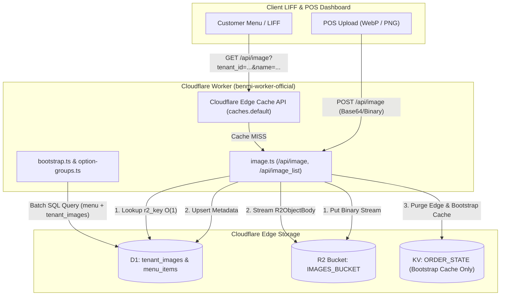
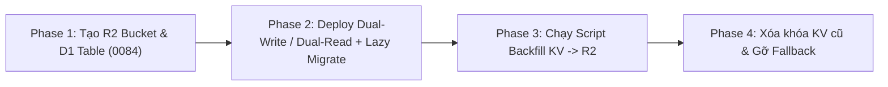

# PDP: Media & Images Migration from Cloudflare KV to R2 + D1 [Migrate/Optimize]

Tài liệu này định nghĩa thiết kế kiến trúc và lộ trình chuyển đổi hệ thống lưu trữ hình ảnh (ảnh món ăn, ảnh tùy chọn combo, logo cửa hàng) từ **Cloudflare KV (Base64 string)** sang **Cloudflare R2 Object Storage (Binary Stream)** kết hợp siêu dữ liệu trên **Cloudflare D1 (`tenant_images`)**.

---

## 1. Executive Summary & Objectives

### Problem Statement (Vấn đề hiện tại)
1. **Phình dung lượng & Nghẽn CPU Worker:** Trong [`image.ts`](file:///Users/duccao/Documents/benmi-order/benmi-worker-official/src/modules/image.ts), ảnh đang được lưu dưới dạng chuỗi `data:image/...;base64,...` trong KV (`ORDER_STATE`). Base64 làm tăng kích thước lưu trữ thêm **~33%**. Mỗi khi khách hàng tải menu, Worker phải đọc chuỗi Base64 vào RAM, chạy Regex, gọi `atob()` và duyệt vòng lặp `for` từng byte để tạo `Uint8Array`, gây tốn CPU time và bộ nhớ.
2. **Thác truy vấn KV (Prefix Waterfall Latency):** Khi một `image_key` không khớp trực tiếp, `getImage()` thực hiện tới **8–10 lệnh `ORDER_STATE.get()` tuần tự** qua 7 tiền tố (`main_`, `snack_`, `combo_`...) và `image_list`. Khi gặp ảnh thiếu hoặc dữ liệu di sản, độ trễ vọt lên ~1.7s/request và làm nghẽn hàng đợi kết nối trình duyệt (tối đa 6 kết nối/domain).
3. **Chi phí & Giới hạn khi Scale 1,000+ Quán:** KV tính phí **\$0.50/GB-tháng** (Free tier chỉ 1 GB) và giới hạn đọc 100k reads/ngày. Trong khi đó, R2 có Free tier **10 GB**, **10 triệu lượt đọc/tháng**, giá vượt mức chỉ **\$0.015/GB-tháng** (rẻ hơn 33 lần) và **\$0.00 phí băng thông ra (Zero Egress)**.
4. **Nợ kỹ thuật Multi-Tenant:** `image.ts` và `bootstrap.ts` vẫn còn các nhánh rẽ `if (tenantId === "benmi")` đọc/ghi key toàn cục `image:${name}` và `image_list`, vi phạm nguyên tắc Zero Hardcoding.

### Goals (Mục tiêu trong phạm vi)
- **Zero Base64 Runtime Overhead:** Lưu trữ và trả về luồng nhị phân nguyên bản (`ReadableStream` / `ArrayBuffer`) từ R2 với `ETag` và `Cache-Control` chuẩn HTTP.
- **Tra cứu Metadata $O(1)$ qua D1 Batch:** Thay thế key `tenant:{id}:image_list` trên KV bằng bảng `tenant_images` trong D1, tích hợp trực tiếp vào `env.DB.batch()` hiện có của [`bootstrap.ts`](file:///Users/duccao/Documents/benmi-order/benmi-worker-official/src/modules/bootstrap.ts) và [`option-groups.ts`](file:///Users/duccao/Documents/benmi-order/benmi-worker-official/src/modules/option-groups.ts) mà không tốn thêm round-trip mạng.
- **Zero-Downtime Migration:** Triển khai cơ chế Dual-Read (ưu tiên R2, tự động fallback và lazy-migrate từ KV nếu chưa kịp backfill) đảm bảo 100% ảnh hiện tại trên Production không bị gián đoạn.
- **Chuẩn hóa 1,000+ Multi-Tenant:** Loại bỏ hoàn toàn nhánh `if (tenantId === "benmi")` sau khi backfill.

### Non-Goals (Ngoài phạm vi)
- Không thay đổi giao diện hay hợp đồng API phía Frontend (`orders-menu.js`, `orders-option-groups.js`, `orders-settings.js`, `client-option-groups.js` vẫn giữ nguyên cách gọi `/api/image` và `/api/image_list`).
- Chưa bắt buộc chuyển đổi sang trả phí Cloudflare Images (paid add-on) ở giai đoạn này; vẫn giữ cơ chế nén WebP/PNG tại trình duyệt POS khi upload.

---

## 2. Context & Current Architecture

Hiện tại vòng đời hình ảnh đi qua 4 điểm chạm chính trong codebase:
1. **[`benmi-worker-official/src/modules/image.ts`](file:///Users/duccao/Documents/benmi-order/benmi-worker-official/src/modules/image.ts)**:
   - `getImageList`: Đọc mảng JSON từ KV `tenant:${tenantId}:image_list`.
   - `getImage`: Tìm chuỗi Base64 trong KV qua tên gốc, 7 tiền tố danh mục, tên lược bỏ tiền tố và `image_list`, sau đó giải mã sang `Uint8Array`.
   - `updateImage`: Nhận `{ name, dataUri }` từ POS, ghi vào KV `tenant:${tenantId}:image:${name}` và cập nhật mảng `image_list`.
   - `deleteImage`: Xóa tất cả tổ hợp key tiền tố trên KV, đồng thời chạy SQL `UPDATE menu_items SET image_key = NULL` để tránh link ảnh hỏng.
2. **[`benmi-worker-official/src/modules/option-groups.ts`](file:///Users/duccao/Documents/benmi-order/benmi-worker-official/src/modules/option-groups.ts)**:
   - `loadOptionCatalog()` (L124): Đọc `tenant:${tenantId}:image_list` từ KV để kiểm chứng `product.image_key` trước khi xuất `imageUrl` trong `groupOptions()` (L197).
   - `saveOptionEntity()` (L473): Khi chủ quán gỡ ảnh khỏi sản phẩm trong Unified Menu (`js/orders-option-groups.js`), hàm này xóa key ảnh tương ứng trên KV và cập nhật `image_list`.
3. **[`benmi-worker-official/src/modules/bootstrap.ts`](file:///Users/duccao/Documents/benmi-order/benmi-worker-official/src/modules/bootstrap.ts)**:
   - `getTenantBootstrap()` (L874–L905 & L1070–L1074): Đọc `image_list` từ KV để quyết định gán `imageUrl` cho từng món trong `catalog`.
4. **Frontend POS Uploaders**:
   - [`js/orders-option-groups.js`](file:///Users/duccao/Documents/benmi-order/js/orders-option-groups.js) (L1338–L1351, L1428–L1442): Nén ảnh sang WebP (`900px`, quality `0.85`), đặt `imageKey = "product:" + id`, gọi `POST /api/image`.
   - [`js/orders-menu.js`](file:///Users/duccao/Documents/benmi-order/js/orders-menu.js) (L5161–L5238): Nén ảnh sang WebP (`800px`, quality `0.82`), đặt `imageKey = "${cat.id}_${name}"`, gọi `POST /api/image`.
   - [`js/orders-settings.js`](file:///Users/duccao/Documents/benmi-order/js/orders-settings.js) (L825–L853): Nén logo cửa hàng sang PNG (`512px`), đặt `name = "store_logo"`, gọi `POST /api/image`.

---

## 3. Proposed Architecture

### 3.1. Sơ đồ luồng dữ liệu mới (System Diagram)



### 3.2. Cấu hình Cloudflare `cf` CLI & R2 Bindings
Hệ thống sử dụng Cloudflare `cf` CLI với file cấu hình [`benmi-worker-official/cloudflare.config.ts`](file:///Users/duccao/Documents/benmi-order/benmi-worker-official/cloudflare.config.ts). Bổ sung binding `IMAGES_BUCKET` cho cả 3 môi trường:

| Môi trường (`--mode`) | R2 Bucket Name | D1 Database |
| :--- | :--- | :--- |
| `dev` | `benmi-images-dev` | `blab-db-dev` |
| `test` / `staging` | `benmi-images-test` | `blab-db-test` |
| `production` | `benmi-images-production` | `blab-db-production` |

Cập nhật [`benmi-worker-official/src/types/env.ts`](file:///Users/duccao/Documents/benmi-order/benmi-worker-official/src/types/env.ts):
```typescript
export interface Env {
  // ... existing bindings
  ORDER_STATE: KVNamespace;
  DB: D1Database;
  IMAGES_BUCKET?: R2Bucket; // Optional trong giai đoạn chuyển giao để an toàn tuyệt đối
}
```

### 3.3. Thiết kế Schema D1 (`0084_create_tenant_images.sql`)
Tạo migration mới tại `benmi-worker-official/migrations/0084_create_tenant_images.sql` (không dùng FK cứng sang bảng `tenants` không tồn tại để tương thích với `tenant_config` và cơ chế `tenant_lifecycle`):

```sql
-- Migration 0084: Create tenant_images metadata table for R2 Object Storage
CREATE TABLE IF NOT EXISTS tenant_images (
    tenant_id TEXT NOT NULL,
    name TEXT NOT NULL,                  -- Canonical key: e.g. 'product:item_123', 'store_logo', hoặc legacy key
    bare_name TEXT NOT NULL,             -- Tên đã lược bỏ prefix (phục vụ O(1) fallback lookup cho dữ liệu cũ)
    r2_key TEXT NOT NULL,                -- Đường dẫn thực tế trên R2: tenants/{tenant_id}/images/{sha256_or_name}
    content_type TEXT NOT NULL DEFAULT 'image/webp',
    byte_size INTEGER NOT NULL DEFAULT 0,
    etag TEXT DEFAULT NULL,
    created_at TEXT NOT NULL DEFAULT (datetime('now')),
    updated_at TEXT NOT NULL DEFAULT (datetime('now')),
    PRIMARY KEY (tenant_id, name)
);

CREATE INDEX IF NOT EXISTS idx_tenant_images_bare
ON tenant_images(tenant_id, bare_name);
```

> [!TIP]
> **Giải quyết triệt để bài toán Prefix Waterfall:** Cột `bare_name` kèm index `idx_tenant_images_bare` cho phép tìm ảnh của các món cũ (vốn lưu dưới dạng `main_TênMón` hoặc `TênMón`) chỉ bằng **1 câu truy vấn SQL duy nhất**:
> `SELECT r2_key, content_type, etag FROM tenant_images WHERE tenant_id = ? AND (name = ? OR bare_name = ?) LIMIT 1`
> Thay vì phải bắn 8–10 lệnh `KV.get()` nối tiếp nhau như trước.

### 3.4. Thiết kế Chi tiết Backend (`image.ts`, `option-groups.ts`, `bootstrap.ts`)

1. **Ghi ảnh (`updateImage` trong `image.ts`)**:
   - Giải mã `dataUri` sang `Uint8Array` một lần duy nhất lúc upload.
   - Chuẩn hóa `r2Key = "tenants/" + tenantId + "/images/" + encodeURIComponent(name)`.
   - Ghi nhị phân lên R2:
     ```typescript
     await env.IMAGES_BUCKET.put(r2Key, binary, {
       httpMetadata: { contentType: mime }
     });
     ```
   - Upsert vào bảng `tenant_images` trong D1.
   - Gọi `invalidateBootstrapCache(tenantId, env)`.

2. **Đọc ảnh (`getImage` trong `image.ts`)**:
   - **Tầng 1 (R2 + D1)**: Truy vấn `tenant_images` theo `(tenant_id, name)` hoặc `bare_name`. Nếu có `r2_key`, gọi `env.IMAGES_BUCKET.get(row.r2_key)` và trả về `new Response(obj.body, ...)` trực tiếp dưới dạng `ReadableStream` (không tốn CPU/RAM giải mã Base64).
   - **Tầng 2 (Lazy-Migration Fallback từ KV)**: Nếu chưa tìm thấy trong D1 (ảnh cũ chưa backfill), đọc từ KV như logic cũ. Nếu tìm thấy trong KV:
     - Dùng `ctx.waitUntil()` (hoặc chạy bất đồng bộ) tự động ghi nhị phân lên R2 và chèn vào `tenant_images` để từ lần gọi thứ 2 trở đi đi thẳng vào R2.
   - **Headers chuẩn CDN**:
     - Khi tìm thấy (200 OK): `Cache-Control: public, max-age=3600, stale-while-revalidate=86400`, kèm `ETag`.
     - Khi không tìm thấy (404 Not Found): `Cache-Control: public, max-age=60` (chống nghẽn Worker).

3. **Tích hợp vào `loadOptionCatalog` & `getTenantBootstrap`**:
   - Thêm câu lệnh `SELECT name, bare_name FROM tenant_images WHERE tenant_id = ?` trực tiếp vào mảng `env.DB.batch([...])` sẵn có trong `loadOptionCatalog()` ([`option-groups.ts`](file:///Users/duccao/Documents/benmi-order/benmi-worker-official/src/modules/option-groups.ts#L74)) và `getTenantBootstrap()` ([`bootstrap.ts`](file:///Users/duccao/Documents/benmi-order/benmi-worker-official/src/modules/bootstrap.ts#L459)).
   - Trong giai đoạn chuyển giao, gộp kết quả từ bảng `tenant_images` với `tenant:${tenantId}:image_list` (nếu còn) thành một `Set<string>` duy nhất. Sau khi backfill hoàn tất, bỏ hoàn toàn lệnh đọc KV `image_list`.

4. **Đồng bộ khi xóa ảnh (`deleteImage` & `saveOptionEntity`)**:
   - Khi xóa ảnh qua `DELETE /api/image` hoặc khi gỡ ảnh sản phẩm trong `saveOptionEntity()` ([`option-groups.ts`](file:///Users/duccao/Documents/benmi-order/benmi-worker-official/src/modules/option-groups.ts#L473)):
     - Xóa object trên `env.IMAGES_BUCKET.delete(r2Key)`.
     - Xóa dòng trong `tenant_images` và đặt `menu_items.image_key = NULL`.

---

## 4. Migration & Rollout Strategy (Zero-Downtime)



- **Phase 1 (Infrastructure & Schema):** Khởi tạo R2 buckets và chạy migration `0084_create_tenant_images.sql` trên Dev, Staging, Production. Hệ thống hiện tại vẫn chạy bình thường 100%.
- **Phase 2 (Dual-Read & Lazy Migration):** Deploy code mới. Mọi ảnh mới upload từ POS sẽ đi thẳng vào R2 + D1. Ảnh cũ nếu được khách mở xem sẽ tự động được lazy-migrate từ KV sang R2, hoặc đọc dự phòng từ KV.
- **Phase 3 (Active Backfill):** Chạy script quản trị quét toàn bộ các tenant hiện có (`benmi`, `jiangjiejie`, `zhadantongxue`, `dapinglin`, `haoshiguoshao`, `blab_demo`...), chuyển đổi toàn bộ ảnh Base64 còn lại trên KV sang R2 + D1.
- **Phase 4 (Cutover & Cleanup):** Sau khi xác nhận 100% ảnh trong `image_list` đã nằm trong `tenant_images` và R2, xóa các key `tenant:*:image:*`, `image:*`, `tenant:*:image_list` khỏi KV và gỡ bỏ code fallback KV.
- **Rollback Plan:** Trong suốt Phase 2 và Phase 3, dữ liệu ảnh trên KV vẫn được giữ nguyên (chưa xóa). Nếu phát sinh sự cố với R2 binding, chỉ cần gỡ binding `IMAGES_BUCKET` hoặc revert commit là hệ thống tự động đọc lại từ KV ngay lập tức.

---

## 5. Alternatives Considered & Trade-offs

| Phương án | Ưu điểm | Nhược điểm | Quyết định |
| :--- | :--- | :--- | :--- |
| **A. Giữ nguyên Cloudflare KV (Status Quo)** | Không cần sửa code. | Phình +33% dung lượng do Base64; tốn CPU Worker decode từng byte; đắt gấp 33 lần khi scale; tốn nhiều lệnh đọc KV. | **Loại bỏ** |
| **B. Cloudflare R2 + D1 Metadata (Đề xuất)** | Free 10GB + 10M reads/tháng; \$0 Egress; Stream nhị phân trực tiếp tốn ~0ms CPU; tra cứu metadata $O(1)$ cùng batch D1; không đổi API Frontend. | Cần tạo R2 bucket và chạy 1 bước backfill ảnh cũ. | **Lựa chọn** |
| **C. Cloudflare Paid Images** | Có sẵn CDN resize tự động theo URL. | Tốn phí cố định hàng tháng (\$5–\$10/tháng ngay cả khi ít dùng), phải sửa toàn bộ định dạng URL ảnh ở Frontend. | **Không chọn lúc này** (Có thể bật sau trên nền R2) |

---

## 6. Cross-Cutting Concerns

- **Security & Tenant Isolation:**
  - Mọi khóa R2 đều bắt buộc phân vùng theo tiền tố `tenants/${tenantId}/images/...`.
  - Kiểm tra giới hạn kích thước payload (`<= 5MB`) và định dạng MIME hợp lệ (`image/webp`, `image/png`, `image/jpeg`, `image/gif`) trước khi ghi vào R2.
- **Performance & Caching:**
  - Sử dụng `ReadableStream` từ `R2ObjectBody.body` truyền thẳng vào `new Response()`, giảm mức sử dụng RAM của Worker từ ~5–10MB xuống ~0MB cho mỗi request ảnh.
  - Hỗ trợ header `If-None-Match` với `object.httpEtag` để trả về `304 Not Modified` tức thì (0 byte truyền tải khi trình duyệt kiểm tra lại cache).

---

## 7. Step-by-Step Execution Plan

- [ ] **Bước 1: Khởi tạo R2 & Cấu hình (`cloudflare.config.ts`, `env.ts`)**
  - Tạo 3 R2 buckets: `benmi-images-dev`, `benmi-images-test`, `benmi-images-production` bằng `cf r2 bucket create`.
  - Khai báo `IMAGES_BUCKET: bindings.r2({ bucketName: ... })` trong `benmi-worker-official/cloudflare.config.ts`.
- [ ] **Bước 2: Database Migration (`0084_create_tenant_images.sql`)**
  - Tạo file migration `0084_create_tenant_images.sql`.
  - Chạy `npm run db:migrations:apply:dev`, `staging`, `production`.
- [ ] **Bước 3: Refactor Backend (`image.ts`, `option-groups.ts`, `bootstrap.ts`)**
  - Cập nhật `updateImage`, `getImage`, `getImageList`, `deleteImage` trong `image.ts` dùng R2 + D1 (kèm Dual-Read fallback KV).
  - Cập nhật `loadOptionCatalog` và `saveOptionEntity` trong `option-groups.ts`.
  - Cập nhật `getTenantBootstrap` trong `bootstrap.ts`.
- [ ] **Bước 4: Backfill & Cutover**
  - Chạy script backfill chuyển toàn bộ ảnh hiện có từ KV sang R2 + D1.
  - Kiểm증 trên Production và dọn dẹp các key ảnh Base64 cũ trên KV.

---

## 8. Verification & Test Plan

- **Automated Verification:**
  - Chạy `npm run check` đảm bảo không ảnh hưởng scope frontend.
  - Chạy `node --test tests/test_customer_option_images_browser.cjs` xác minh toàn bộ 11 kịch bản hiển thị ảnh tùy chọn và combo.
  - Build kiểm tra TypeScript backend: `cd benmi-worker-official && npm run build:production`.
- **Manual / API Verification:**
  - Upload ảnh món ăn mới trên POS Unified Menu và logo cửa hàng trong Settings.
  - Kiểm tra `curl -I "https://benmi-worker-official.thuanmnc.workers.dev/api/image?tenant_id=benmi&name=..."` trả về `200 OK`, `Content-Type: image/webp`, `ETag`, và thời gian phản hồi `< 20ms`.
  - Kiểm tra món không có ảnh (như trên `jiangjiejie`) trả về `imageUrl: null` trong bootstrap và mở modal combo tức thì (`0ms`).
