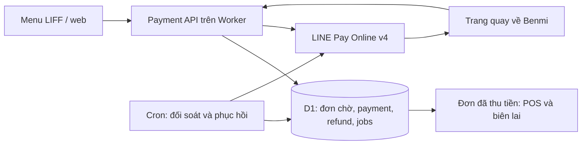

# PDP: LINE Pay Online API v4 — New

Ngày: 2026-11-01. Trạng thái: đã triển khai cục bộ; chưa bật merchant, chưa kiểm chứng sandbox hoặc triển khai remote. Xem `implementation-runbook.md` cùng thư mục để vận hành.

## 1. Mục tiêu và phạm vi đề xuất

Đã thống nhất với người dùng: mỗi tenant dùng merchant LINE Pay riêng; khách trả tiền trước khi đơn vào hàng đợi POS.

MVP đề xuất: LINE Pay Online API v4 cho đơn mang đi mới qua menu LIFF/web, tiền TWD, thanh toán một lần toàn bộ đơn; POS xem trạng thái và hoàn toàn bộ tiền. Giữ lựa chọn trả tại quầy. Chưa gồm Offline API/quét mã tại quầy, đơn ăn tại bàn/gọi thêm, sửa giá sau thanh toán, hoàn một phần, chia hóa đơn, thanh toán định kỳ hoặc nền tảng thu hộ. Các giới hạn này là đề xuất, chưa phải lựa chọn người dùng đã xác nhận.

Chính sách đã chốt: quán chủ động bấm “Hoàn tiền LINE Pay”, xác nhận toàn bộ số tiền và lý do. Từ chối đơn không tự hoàn tiền; POS hiển thị “Đã hủy — chưa hoàn tiền”. Trên đơn đã thu, hoàn riêng cũng cần phiên POS hợp lệ và xác nhận rõ số tiền. Lỗi hoàn tiền phải còn hiển thị để xử lý, không được báo đã hoàn khi chưa xác minh.

Thành công khi: một checkout chỉ tạo một khoản thu hợp lệ và một đơn phục vụ; tiền và tenant khớp; không thất lạc giao dịch khi khách đóng LINE; thu/hoàn chưa rõ kết quả được đối soát; tenant chưa bật tính năng tiếp tục hoạt động bình thường.

## 2. Hiện trạng và những phần cần thay đổi

- `src/modules/order-detail.ts` đã tính giá từ catalog, kiểm tra lựa chọn và tạo snapshot. Tái sử dụng logic này; không dùng tổng tiền hoặc tên món từ client làm dữ liệu quyết định thu tiền.
- `src/modules/order-detail-write.ts` hiện ghi đơn `NEW` và chuẩn bị receipt ngay. Cần tách bước chuẩn bị/lưu đơn khỏi bước phát hành đơn cho POS và thông báo khách.
- `orders.status = PAID` hiện là trạng thái kết thúc đơn ăn tại bàn. Giữ ngữ nghĩa này, thêm trạng thái tiền riêng; không biến một đơn takeaway vừa trả tiền thành đơn đã phục vụ xong.
- Có cron mỗi phút và hàng đợi biên lai trong D1; bổ sung công việc thanh toán bền vững vào cơ chế xử lý định kỳ, giới hạn số bản ghi mỗi lượt và có lease chống chạy trùng.
- Có `staff_sessions` và xác minh bearer token. Luồng tiền phải kiểm tra phiên tại backend; mở capability payment độc lập với tính năng đặt món tại quầy. Những đường cập nhật đơn cũ cũng phải qua cùng guard đối với đơn LINE Pay.
- Có mẫu mã hóa secret AES-GCM cho LINE Messaging. Tái sử dụng nguyên tắc mã hóa, nhưng credential, key namespace và dữ liệu LINE Pay phải riêng.

Đề xuất v3 cũ chỉ là tài liệu lịch sử. Không kế thừa việc lưu secret plaintext, nhận amount từ callback, hoặc khẳng định bắt buộc có proxy IP tĩnh. Tài liệu [prerequisites hiện tại](https://developers-pay.line.me/online/prerequisites) mô tả HMAC cho Online v4; mục allowlist ở [offline prerequisites](https://developers-pay.line.me/offline/prerequisites) thuộc Offline v2.x. Chọn Worker gọi trực tiếp; kiểm tra yêu cầu của merchant thực tế trước pilot, chỉ bổ sung egress nếu có yêu cầu được xác nhận.

## 3. Thiết kế nghiệp vụ và kỹ thuật

### Dữ liệu và phân tách trạng thái

Thêm bảng migration mới theo số tiếp theo ở thời điểm triển khai; không dùng lại số migration trong đề xuất v3.

| Thành phần | Dữ liệu và ràng buộc chính |
| --- | --- |
| `tenant_payment_connections` | Tenant, provider, môi trường sandbox/production, channel ID, secret mã hóa, phiên bản khóa, revision, enabled. Khóa duy nhất theo tenant/provider/environment/revision; mỗi môi trường chỉ một kết nối hiện hành. |
| `payments` | ID nội bộ, tenant/order, attempt, connection revision, provider order ID, transaction ID dạng TEXT, amount/currency, status, request hash, idempotency key, lease, thời gian, provider result và paymentProvider nếu có. |
| `payment_refunds` | Payment, số tiền, operation ID, trạng thái, mã giao dịch hoàn, lý do, người/phiên yêu cầu và thời gian. MVP tối đa một lần hoàn toàn bộ thành công. |
| `payment_jobs` / audit | Việc cần xác minh, next_attempt_at, số lần thử, lease, lỗi đã lọc dữ liệu nhạy cảm; sự kiện chuyển trạng thái và nguyên nhân. |
| `orders` | Thêm `PENDING_PAYMENT` vào trạng thái phục vụ, tra payment qua tenant/order key; API cung cấp projection payment độc lập. Đơn cũ không được tự gán là đã trả tiền mặt. |

Payment đi từ `CREATED → REQUESTING → PENDING → CONFIRMING → PAID`; kết quả chắc chắn chưa thu có thể là `CANCELLED/EXPIRED/FAILED`. Khi mất phản hồi dùng `UNKNOWN`, không tự suy diễn thất bại. Refund có `PENDING/PROCESSING/UNKNOWN/SUCCEEDED/FAILED`; projection đơn thể hiện `REFUND_PENDING/REFUNDED/REFUND_FAILED` phù hợp.

Tiền TWD lưu dưới dạng số nguyên đơn vị đồng trong MVP. Từ chối tổng không nguyên hoặc <= 0 với mã lỗi rõ ràng; không làm tròn âm thầm giá bán. Provider transaction ID phải parse lossless thành string ngay từ response text, không chuyển qua JavaScript Number. [Transaction ID và response v4](https://developers-pay.line.me/online-api-v4)

D1 là nguồn quyết định trạng thái tiền, lease và idempotency; KV chỉ phục vụ cấu hình công khai trong bootstrap. Mọi truy vấn/ràng buộc phải có tenant và môi trường. Lưu connection revision trên payment để đổi cấu hình không làm giao dịch cũ dùng nhầm merchant. Không xóa connection còn giao dịch cần đối soát/hoàn; xoay secret của cùng channel phải duy trì khả năng xử lý giao dịch cũ.

### Checkout, xác nhận và phục hồi

1. Checkout gửi payload detailVersion 1 hiện hành, idempotency key và bằng chứng phiên checkout. Backend kiểm tra tenant active, tính năng bật, merchant sẵn sàng, loại đơn, giờ bán và tính lại giá/menu. Lưu snapshot bất biến cùng đơn `PENDING_PAYMENT` và payment trước khi gọi LINE Pay.
2. Tạo provider order ID riêng cho từng attempt. Cùng idempotency key và payload trả lại kết quả hiện hành; key cũ với payload khác trả 409. Khóa một attempt đang xử lý trên một checkout bằng ràng buộc D1, không bằng nút disabled hoặc KV.
3. Gọi Request v4, lưu transaction ID và URL trước khi trả về trình duyệt. Chỉ gọi confirm với amount/currency đã lưu; callback không được ghi đè tenant, transaction hoặc giá.
4. Trang quay về trao đổi state ngẫu nhiên với backend; backend kiểm tra state thuộc payment nào và hỏi LINE Pay. Chỉ khi xác minh đã thu thành công mới atomically ghi `PAID`, chuyển đơn `PENDING_PAYMENT → NEW`, tạo receipt/outbox duy nhất. POS và in tự động chỉ xử lý đơn đã phát hành.
5. Request/confirm/refund timeout tạo việc đối soát. Cron tra trạng thái request và chi tiết giao dịch; khi có bằng chứng khách đã xác thực và checkout còn hợp lệ, hoàn tất confirm. Callback và cron dùng cùng state machine/lease. Nếu Worker chết sau khi LINE Pay thu nhưng trước khi D1 ghi, lần đối soát kế tiếp phục hồi đơn và outbox.
6. Nếu Request mất response trước khi có transaction ID, tra cứu bằng provider order ID. Không tạo attempt mới khi attempt trước chưa được chứng minh kết thúc an toàn; trường hợp không thể xác định chuyển sang cần xử lý và hiển thị trên POS.
7. Theo thời hạn LINE Pay; không đặt thời hạn 10–20 giây hoặc 15 phút ở Benmi. Chỉ kết luận hủy/hết hạn sau khi provider xác nhận. Giao dịch đã thu muộn sau khi checkout/tenant không còn được phục vụ phải được ghi nhận và hiển thị cần xử lý để quán chủ động hoàn tiền, không bị bỏ qua.

Các API provider dùng: Request, Confirm, Check payment request status, Retrieve payment details và Refund. HMAC ký đúng chuỗi body thực gửi; nonce mới mỗi lần gọi. Adapter kiểm tra mã nghiệp vụ, không chỉ HTTP 200. Confirm timeout đặt 45 giây, Request 15 giây, Refund 30 giây; kết quả quá hạn chuyển đối soát. Hướng dẫn chính thức yêu cầu confirm tối thiểu 40 giây. [Confirm](https://developers-pay.line.me/online-api-v4/confirm-payment), [Request](https://developers-pay.line.me/online-api-v4/request-payment), [Refund](https://developers-pay.line.me/online-api-v4/refund)

Không tự retry POST thu/hoàn khi chưa biết lần trước có thành công không. Các job truy vấn dùng backoff và giới hạn; trạng thái chưa rõ vẫn được lưu và cảnh báo sau 5 phút. Không quét toàn bộ bảng/tenant: index status + next_attempt_at, mặc định xử lý tối đa 12 job mỗi lượt với concurrency 4, đo backlog để điều chỉnh.

### Giao diện API của Benmi

| API dự kiến | Hợp đồng tối thiểu |
| --- | --- |
| `POST /api/payments/linepay/request` | Payload detailVersion 1, idempotency key, checkout capability; trả paymentId, orderId, status, server total/currency và paymentUrl khi sẵn sàng. |
| `POST /api/payments/:id/confirm` | State/capability hợp lệ; backend lấy transaction/amount từ D1. Trả payment projection hoặc 202 khi đang xác minh. |
| `GET /api/payments/:id` | Cần capability/phiên có quyền; trả trạng thái tối thiểu, số tiền và đơn liên quan; no-store. |
| `POST /api/payments/:id/refunds` | Phiên POS + operation ID + lý do; số tiền do backend lấy từ phần đã thu còn được hoàn, MVP hoàn toàn bộ. |

Endpoint no-store `/api/payments/config` cung cấp khả năng thanh toán công khai: enabled, currency và các loại đơn được hỗ trợ. Không phát channel secret ra browser. API order/history thêm `payment: { method, status, amount, currency, paidAt, refundedAmount }`; giao dịch lịch sử chưa biết giữ null/unknown, không suy luận từ trạng thái phục vụ.

Để hỗ trợ menu web lẫn LIFF, client tạo capability ngẫu nhiên 256-bit trước request, backend chỉ lưu hash; binding theo tenant/payment, dùng để tiếp tục checkout và đọc trạng thái. Capability không xác nhận danh tính LINE. Trước khi gắn userId/gửi receipt phải xác minh token LINE ở backend, không tin userId client tự khai; nếu không xác minh được thì chỉ hiển thị receipt trên web. Redirect state ngắn hạn và capability có phạm vi giới hạn; không đưa secret/PII vào URL, telemetry hoặc referrer. Callback URL lấy từ domain cấu hình được phép, không lấy URL tùy ý từ client.

### POS, chỉnh đơn và hoàn tiền

- Checkout hiển thị trả tại quầy/LINE Pay khi đúng tenant và loại đơn; trạng thái đang xác minh có nút kiểm tra lại. Không tự chuyển sang gửi đơn tiền mặt hoặc LINE text fallback khi payment API lỗi. Giữ cart đến khi có kết quả chắc chắn, tránh xóa mất đơn đang trả.
- POS, lịch sử, receipt và bản in phân biệt tiền mặt/chưa rõ, LINE Pay đã thu, đang hoàn, đã hoàn, lỗi cần xử lý. Nút tối thiểu 48px, đầy đủ zh-TW/vi, cache-buster mọi HTML sử dụng JS/CSS đã sửa.
- Với payment còn hiệu lực hoặc đã thu: chặn mọi đường legacy/staff/customer/LINE action thay giá, append, modify hoặc đánh dấu thủ công đã thu. Đơn trả tiền trước nhưng cần đổi món phải hủy/hoàn rồi tạo đơn mới trong MVP. Đơn takeaway vẫn được nhận, hoàn tất và giao theo trạng thái phục vụ hiện có.
- Hủy một đơn đã thu phải giữ trạng thái tiền và hiển thị cần hoàn; chỉ tạo refund intent sau khi quán chủ động xác nhận nút hoàn tiền. Luồng “khách sửa đơn” hiện tại không được dùng cho đơn LINE Pay MVP. Các endpoint cũ không được bypass guard hoàn tiền.
- Báo cáo tách tiền đã thu, đã hoàn và thu ròng theo thời điểm giao dịch; giữ báo cáo doanh số món theo nghiệp vụ hiện hành. Đơn chờ trả/hủy chưa trả không vào doanh thu; hoàn tiền ngày sau có ngày giao dịch riêng.
- Đơn chờ không in, không gửi Flex xác nhận đã đặt thành công, không nằm trong live queue/waiting count. Điều chỉnh query/report/cleanup hiện có để không xóa giao dịch chưa xử lý.

### Bảo mật, vận hành và tính nhất quán

Secret mã hóa AES-GCM trong D1, khóa chủ từ Worker secret riêng cho môi trường; AAD gắn tenant/connection/revision/purpose. Cấu hình merchant MVP qua công cụ quản trị nội bộ xác thực bắt buộc, nhập secret qua stdin/secret store, không qua shell argument/git; chưa làm UI self-service blab-admin. Không dùng fallback admin key mặc định cho thao tác này.

Tái sử dụng staff session verification cho đọc/hoàn tiền; không coi đăng nhập UI là quyền backend. PIN mặc định không đủ điều kiện kích hoạt payment. Giới hạn tốc độ theo tenant/session/IP cho login và tạo payment. Dữ liệu phản hồi payment no-store; log không ghi token, secret, toàn bộ payload khách.

D1 batch ghi payment/order/outbox cùng nhau; sử dụng CAS và constraints để bảo đảm điều kiện thất bại rollback, không giả định UPDATE không khớp dòng sẽ tự làm transaction lỗi. Không thể có transaction ACID chung giữa D1 và LINE Pay: durable intent + đối soát bù đắp khoảng trống này. [D1 batch](https://developers.cloudflare.com/d1/worker-api/d1-database/)

Log/metric gồm tenant, paymentId, provider order/transaction ID, operation, resultCode, latency và transition. Theo dõi tỷ lệ thu thành công, UNKNOWN quá 5 phút, refund pending, paid chưa phát hành đơn, backlog đối soát và outbox. POS phải có danh sách cần xử lý và thao tác đối soát lại, không chỉ dựa vào log kỹ thuật.

## 4. Lộ trình triển khai và rollout

| Mốc | Kết quả bàn giao | Ước lượng 1 dev quen codebase |
| --- | --- | --- |
| P0 — Sandbox và contract | Merchant sandbox, test Request/Confirm/Refund từ Worker, quy tắc TWD, callback domain, fixtures response và lỗi; kiểm tra điều kiện production | 1–2 ngày |
| P1 — Nền tảng dữ liệu | Migration, credential provisioning, trạng thái tiền, session capability, idempotency/CAS, đơn chờ và guard toàn bộ mutation | 3–4 ngày |
| P2 — Payment engine | Adapter v4, Request/Confirm, jobs đối soát, phục hồi sau crash và receipt/outbox đúng một đơn | 3–4 ngày |
| P3 — Checkout và POS | Chọn phương thức, trang quay về, khôi phục phiên; badge/in/lịch sử; từ chối và hoàn, hàng đợi cần xử lý, báo cáo thu/hoàn | 4–5 ngày |
| P4 — QA và pilot | Tests lỗi/cạnh tranh, iOS/Android LIFF và browser; staging rồi pilot một merchant thật, runbook đối soát/rollback | 3–5 ngày |

Tổng dự kiến 14–20 ngày công, chưa gồm thời gian merchant được duyệt hoặc yêu cầu ngoài MVP. Mỗi mốc là nhóm PR theo thứ tự phụ thuộc; cập nhật ước lượng sau P0.

Rollout: dev dùng sandbox → staging dùng sandbox → production code tắt mặc định → pilot một merchant đã sẵn sàng → mở theo tenant. Dùng cấu hình/scrips Cloudflare `cf` hiện có; Node 24. Không thử sandbox trên đơn kinh doanh thật.

Migration chỉ bổ sung, tương thích đơn cũ. Bootstrap đổi cấu hình phải invalidate cache; backend đọc cờ cho quyết định tạo giao dịch từ D1. Đóng cờ chỉ ngừng giao dịch mới, vẫn chạy confirm/đối soát/hoàn cho giao dịch đang tồn tại. Không xóa bảng/secret/ledger khi rollback; nếu rollback app, phải giữ payment processor tương thích đến khi xử lý xong mọi giao dịch.

Trước production cần merchant được phép Online v4/TWD, credential đúng môi trường, callback HTTPS, quyền refund và kịch bản lỗi sandbox đã đạt. Nếu provider áp điều kiện mạng bổ sung, chưa bật merchant đó cho tới khi xử lý xong.

## 5. Phương án khác và đánh đổi

| Phương án | Lợi ích | Đánh đổi / quyết định |
| --- | --- | --- |
| Thu trước, refund nếu quán từ chối | Khớp ý định người dùng; POS chỉ nhận đơn đã thu | Phải có hoàn tiền và đối soát ngay MVP; chọn phương án này |
| Authorize trước, capture khi quán nhận | Giảm hoàn tiền với đơn bị từ chối | Thêm thời hạn authorization, capture/void và race nhận đơn; để giai đoạn sau |
| Online + Offline ngay | Phủ cả LIFF và thu tại quầy | Thêm thiết bị quét và API/state khác; chưa đưa vào MVP |
| Chỉ lưu cột paid trên orders | Làm nhanh | Không theo dõi retry, nhiều attempt, refund hoặc crash; không chọn |

## 6. Kế hoạch kiểm thử và nghiệm thu

- Contract: HMAC đúng bytes; transaction ID 19 chữ số không mất số; HTTP 200 kèm lỗi; mã check trạng thái không bị hiểu nhầm là đã thu; amount/currency lấy từ snapshot; không rò secret giữa tenant hoặc môi trường.
- Tính tiền: modifier/bundle/discount; giá đổi trước Request; giả mạo total; số lẻ TWD; đơn hết món/quán đóng; không sửa số tiền sau Request.
- Cạnh tranh: bấm hai lần, hai tab, callback lặp, callback cùng cron, hai máy refund; key cũ khác payload trả 409; chỉ một đơn, một receipt intent và khoản thu/hoàn hợp lệ.
- Fault injection: timeout Request trước khi lưu transaction ID; timeout Confirm/Refund sau provider đã xử lý; Worker chết trước D1 commit; outbox lỗi; mất session/đóng LINE/không redirect; thu muộn sau local expiry; không tạo attempt mới khi kết quả cũ UNKNOWN.
- Hủy/hoàn: từ chối, hết món, hủy tự động, provider từ chối refund; lỗi hoàn vẫn xuất hiện; thao tác từ API cũ không bypass; đổi merchant/đóng tính năng trong khi payment đang chạy.
- Phân quyền: giả tenant/order/transaction/state; token khách không đọc/hoàn payment khác; staff session sai tenant, hết hạn hoặc revoked; callback URL injection; userId tự khai không gửi thông báo cho người khác.
- UI thực tế: iOS/Android LIFF, Safari/Chrome bên ngoài, quay lại/back/reload, mạng chậm; iPad POS hai ngôn ngữ, in receipt và danh sách cần xử lý.
- Hồi quy: tiền mặt, đơn cũ, staff ordering, append/modify đơn chưa dùng LINE Pay, report, receipt; tenant chưa bật không đổi hành vi. Đơn đã thu chưa phục vụ vẫn hiện đúng live queue.
- Trong phát triển: `npm run check`, backend `npm run --prefix benmi-worker-official check`, test payment mục tiêu cùng `npm run test:order-details`, `npm run test:line-order-receipts` khi liên quan. Bump và kiểm tra cache-buster. Chạy `npm run test:release` ở cổng PR/release theo quy chuẩn repo.
- Nghiệm thu pilot: đối chiếu từng order/payment/refund trong D1 với Merchant Center; không có giao dịch đã thu bị bỏ sót, thu/hoàn trùng, sai tenant hoặc bí mật trên frontend. Không mở thêm tenant khi còn mismatch chưa giải thích được.

## 7. Tài liệu API để triển khai

- [Online API v4](https://developers-pay.line.me/online-api-v4)
- [Basic payment](https://developers-pay.line.me/online/implement-basic-payment)
- [Check payment request status](https://developers-pay.line.me/online-api-v4/check-payment-request-status)
- [Retrieve payment details](https://developers-pay.line.me/online-api-v4/retrieve-payment-details)
- [Refund](https://developers-pay.line.me/online-api-v4/refund)
- [API change log](https://developers-pay.line.me/api-change-log)

Phạm vi cuối cùng: Online v4, đơn mang đi mới, merchant riêng, quán chủ động hoàn toàn bộ. Kiểm chứng sandbox/thiết bị LINE thật và pilot production là cổng phát hành còn cần thực hiện.
