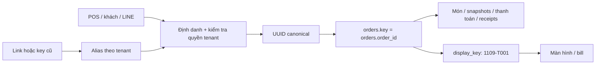

# PDP: Chuyển định danh đơn hàng sang UUID — Migrate

Ngày: 2026-11-09. Trạng thái: đề xuất; chưa sửa runtime hoặc dữ liệu production.

## 1. Executive Summary & Objectives

Chuẩn hóa UUID do server tạo thành định danh duy nhất dùng trong mọi thao tác đơn hàng. Mã lấy món độc lập, ví dụ `1109-T001`, không dùng làm khóa ghi dữ liệu.

Đề xuất giữ tên cột `orders.key` trong giai đoạn chuyển đổi, nhưng giá trị của mọi đơn mới sẽ bằng `order_id` (UUID). Sau khi chuyển đổi lịch sử, mọi `order_key` cũng chứa UUID. Không cần đổi tên toàn bộ cột để đạt mục tiêu này.

Tiêu chí hoàn thành: không còn đơn có `key != order_id`; không còn liên kết nội bộ dùng mã hiển thị; link cũ vẫn xác định đúng đơn qua alias; không thay đổi số tiền, trạng thái, nội dung hay danh tính giao dịch thanh toán.

Ngoài phạm vi: thuật toán giá, cấu hình tenant, thay ngày kinh doanh/múi giờ, đổi mã giao dịch bên LINE Pay, xóa lịch sử hoặc thay request idempotency bằng order UUID.

## 2. Context & Current Architecture

- `orders.key` là primary key, được các bảng con tham chiếu.
- `orders.order_id` đã có unique index; trigger điền UUID cho đơn cũ. `uuid` là request idempotency, một khái niệm khác.
- `src/modules/order-identity.ts`: `resolveOrderKey()` nhận key hoặc order UUID và trả key lưu trữ; không dùng display number để sửa đơn.
- `src/modules/order-detail-write.ts`, `staff.ts`: đơn mới có thể dùng display number làm key, fallback UUID khi đã có key trùng.
- `src/modules/payments.ts`: luồng LINE Pay đã tạo `key = order_id = UUID`.
- `migrations/0055_expand_order_identity.sql`: cấm đổi key/tenant/order UUID của đơn.
- `migrations/0069_order_detail_snapshots.sql`: cấm UPDATE snapshot.
- `migrations/0075_line_pay_v4.sql`: bảo vệ đơn và món có liên kết thanh toán.

Danh sách đã xác định cần kiểm kê: `order_items`, `order_detail_snapshots`, `payments`, `pending_actions`, `staff_order_requests`, `line_order_receipts`. Còn có tham chiếu trong JSON replay, LINE postback/link, state trình duyệt, cache, danh sách đã in và active table projections. Trước khi viết migration phải đối chiếu đầy đủ schema thực tế; danh sách này chưa thay thế audit production.

## 3. Proposed Architecture

### Mô hình mục tiêu

| Trường | Vai trò |
|---|---|
| `key` | UUID canonical trong storage, bất biến |
| `order_id` | Cùng UUID với key, giữ để tương thích API hiện tại |
| `display_key` | Mã lấy món, không có tiền tố quán và `#` |
| `business_date` | Ngày đầy đủ, giữ quy tắc UTC+8 hiện tại |
| `uuid` / operation ID | Chống lặp request, giữ nguyên semantics |

Giữ bộ đếm atomic theo tenant + business date + loại đơn. Mã hiển thị được phép trùng giữa các tenant hoặc khác năm. Người dùng có thể tìm theo mã, nhưng kết quả mơ hồ phải yêu cầu thêm ngày/ngữ cảnh; không được chọn đơn bất kỳ để ghi.

Alias dự kiến: `order_identity_aliases(tenant_id, alias, order_id)`, unique `(tenant_id, alias)`, FK tới `orders.order_id`. Mapping chỉ được thêm từ dữ liệu đã kiểm chứng, không cho client tự khai báo. Lưu cả key cũ không phải UUID; phát hiện và xử lý xung đột giữa alias và UUID trước cutover.

API mục tiêu trả `orderId`, `displayKey` và tạm giữ `key` bằng cùng UUID. Mọi client mới gửi `orderId` cho thao tác ghi; adapter biên nhận tham chiếu cũ, resolve sang UUID rồi kiểm tra quyền hiện có. UUID không thay thế xác thực user, staff hoặc payment capability token.

## 4. Migration & Rollout Strategy

### Phase A — Chuẩn bị tương thích

Kiểm kê schema, trigger, stored JSON và các worker/cron/webhook có thể ghi. Kiểm tra order UUID null/trùng, key/UUID chéo, alias mơ hồ, orphan và dữ liệu không đúng tenant. Lưu mapping `tenant, old_key, order_id`, row counts và checksum các trường nghiệp vụ.

Thêm bảng alias và resolver có thể đọc cả dữ liệu cũ lẫn UUID. Alias phải được ghi đầy đủ trước khi đổi tham chiếu. Worker rollback được chọn cũng phải hiểu alias và UUID.

### Phase B — Mọi đơn mới dùng UUID

Sửa tất cả đường tạo đơn: customer detail, legacy API/LINE ingestion còn được hỗ trợ và staff. Đồng bộ với luồng LINE Pay hiện có. Bỏ việc thử dùng display number làm key. Sinh UUID một lần trên server và dùng cùng giá trị cho parent, bảng con và outbox trong giao dịch hiện tại.

Triển khai dev → staging → production. Nếu canary theo tenant, dùng config/capability chung, không hardcode tenant ID. Kiểm tra retry vẫn trả cùng đơn, không tạo payment hoặc biên lai trùng.

### Phase C — Chuyển toàn bộ client và payload

POS, khách, LINE actions, payment view và in dùng UUID cho hành động, display key cho chữ nhìn thấy. Bump cache buster các HTML liên quan. Giữ adapter cho tab cũ, link LINE cũ và bản app đã cài.

Phân loại stored JSON theo vai trò: replay response cũ có thể tiếp tục được chấp nhận qua alias; link đã gửi ra ngoài không thể sửa. Không sửa request hash, capability hash, retry key hoặc transaction ID vì đổi cách định danh.

### Phase D — Chuyển đơn lịch sử

Đây là đợt migration riêng, không phải một câu UPDATE key. Chạy thử trên bản sao staging với đủ trigger và dữ liệu đại diện cho đơn đang hoạt động, snapshot bất biến và thanh toán.

Tạm chặn mọi đường ghi liên quan trong cửa sổ cutover, gồm API, payment reconciliation, cron, webhook và receipt worker; trả lỗi có thể retry trước tác dụng phụ. Chờ tác vụ đang chạy và lease kết thúc. Không bắt đầu nếu không kiểm soát được toàn bộ writer hoặc chưa xử lý được trạng thái payment đang dở.

Migration có kiểm soát chuyển key và các FK bằng mapping, đồng thời xử lý rõ các identity/snapshot/payment guards rồi khôi phục đầy đủ trong cùng đơn vị migration an toàn. Không xóa/tạo lại đơn qua luồng nghiệp vụ vì có DELETE CASCADE và payment guards. Nếu khối lượng không phù hợp một giao dịch, cần thiết kế lại cách chia giai đoạn; không chia batch tùy tiện để lộ liên kết dở dang.

D1 cho phép hoãn kiểm tra FK đến cuối giao dịch, nhưng việc này không bỏ qua trigger hay DELETE CASCADE. Vì vậy phương án SQL cụ thể chỉ được chốt sau audit và diễn tập. Tham khảo [D1 foreign keys](https://developers.cloudflare.com/d1/sql-api/foreign-keys/) và [SQL statements](https://developers.cloudflare.com/d1/sql-api/sql-statements/).

Mở lại ghi khi kiểm tra toàn vẹn, mapping, checksum và trigger đều đạt. Chấp nhận cửa sổ bảo trì ngắn cho Phase D; chưa cam kết zero downtime hay thời lượng khi chưa biết khối lượng production.

### Rollback

Trước Phase D, rollback về bản worker đã chuẩn bị ở Phase A; bản đó vẫn xử lý được đơn mới có UUID. Sau Phase D, ưu tiên rollback ứng dụng tương thích với schema đã chuyển, không tự đổi ngược dữ liệu.

Lưu export/mapping và bookmark trước migration. Chỉ đảo mapping trong cửa sổ chặn ghi sau khi đã diễn tập. [D1 Time Travel](https://developers.cloudflare.com/d1/reference/time-travel/) là biện pháp phục hồi toàn database, không phải rollback riêng một tenant; phải đối soát các giao dịch bên LINE Pay và dữ liệu phát sinh sau bookmark trước khi chọn phục hồi.

## 5. Alternatives Considered & Trade-offs

| Phương án | Lợi ích | Giới hạn |
|---|---|---|
| Chỉ sửa hiển thị | Nhỏ, không đụng lịch sử | Key vẫn có hai dạng |
| Chỉ dùng UUID cho đơn mới | Giảm rủi ro, triển khai sớm | Lịch sử vẫn cần resolver key cũ |
| UUID cho đơn mới + chuyển lịch sử (đề xuất) | Một giá trị định danh cho toàn hệ thống | Cần migration bảo trì và alias lâu dài |
| Đổi tên toàn bộ PK/FK thành order_id ngay | Schema nhìn thống nhất | Phạm vi lớn hơn, không cần để chuẩn hóa giá trị định danh |

## 6. Cross-Cutting Concerns

- Tenant và quyền: mọi resolve/read/write phải kiểm tra tenant; alias không cho vượt ranh giới tenant hoặc ownership.
- Quan sát: theo dõi alias hit/miss, UUID lookup miss, FK/trigger errors, retry conflict, payment reconciliation failure và duplicate receipt. Log UUID + tenant + operation, không log credentials/capability tokens.
- Hiệu năng: giữ index UUID/alias; loại bỏ truy vấn kiểm tra display-key collision ở đường tạo đơn sau cutover. Invalidate cache liên quan và xác minh state cũ qua adapter.
- In ấn: chuẩn hóa khóa chống in trùng, chuyển cả marker key cũ sang cùng UUID trước khi phát lại đơn; không để thay key gây in lại bill.
- Bất biến: giữ số tiền, snapshot payload, revision, timestamps và lịch sử thanh toán. Trường liên kết được chuyển bằng mapping; dữ liệu nghiệp vụ không được suy diễn lại.

## 7. Step-by-Step Execution Plan

- [ ] PR 1: audit, alias schema/resolver và công cụ kiểm chứng mapping.
- [ ] PR 2: chuẩn hóa toàn bộ đường tạo đơn dùng UUID, giữ contract tương thích.
- [ ] PR 3: chuyển client/LINE/in sang UUID cho hành động, mã rút gọn cho hiển thị.
- [ ] PR 4: migration lịch sử, maintenance gate và diễn tập rollback.
- [ ] Dev/staging nghiệm thu; production rollout theo từng cổng kiểm chứng.
- [ ] Sau cutover: ràng buộc mọi insert có key=order_id; ghi số liệu alias và giữ tương thích với link cũ. Dọn cột trùng lặp là thay đổi sau cùng, không phải điều kiện để đạt một UUID canonical.

## 8. Verification & Test Plan

- Cùng mã hiển thị ở hai tenant, hai loại đơn và khác năm vẫn xử lý đúng UUID.
- Retry customer/staff/payment, append, modify, status update và bảng đang phục vụ giữ nguyên identity.
- Link LINE trước migration, pending action, webhook lặp, payment callback và replay response cũ vẫn resolve đúng; truy cập chéo tenant bị từ chối.
- Payment request/confirm/cancel/refund, reconciliation đang chạy và receipt lease không gây double charge, double publish hoặc mất đơn.
- Snapshot revision/hash, tổng tiền, trạng thái và số bản ghi trước/sau khớp; không còn key!=order_id, orphan hoặc alias mơ hồ; `PRAGMA foreign_key_check` sạch.
- Guards được tái tạo đúng và vẫn chặn đổi identity, sửa snapshot, sửa tiền của đơn đã có payment.
- Bill/tem không hiển thị UUID, không in lại vì đổi key; browser cũ nhận retry an toàn trong bảo trì.
- Dùng các suite identity, print identity, staff ordering, order details, LINE receipts và payments; chạy frontend check, backend typecheck và release baseline tại cổng PR/deploy theo quy tắc repo.

Không có code runtime, schema hay dữ liệu production nào được sửa bởi tài liệu này.
